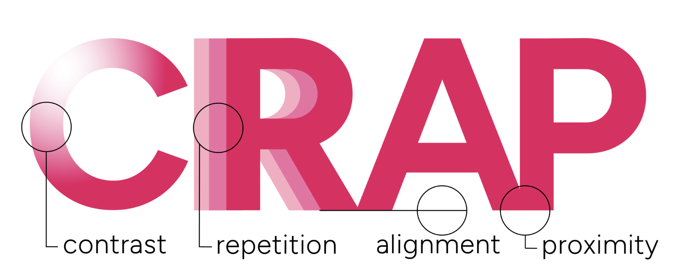
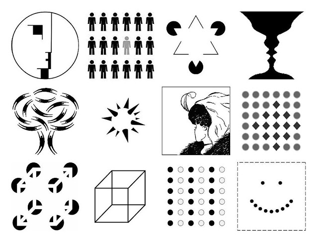
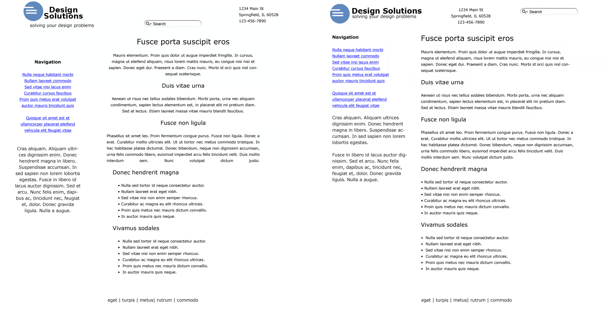

# CRAP : quatre (4) principes de design 
<!-- toc -->

Les principes **CRAP** (contraste, répétition, alignement et proximité), théorisés par Robin Williams, forment la base du design graphique et de la mise en page pour les non-designers. Ils permettent de structurer l’information de manière claire, esthétique et professionnelle.

- [How to Use C.R.A.P. Design Principles For Better UX? | Wingify](https://wingify.com/blog/crap-design-principles/)
- [Principes CRAP pour des présentations](crap_presentations.webp)
- [Lewis University Writing Center CRAP](./crap-resource-revised-pub.pdf)

## Gestalt : Psychologie de la forme 

Les principes CRAP prennent racines dans le concept de la psychologie de la forme (Gestalt) qui s’applique à toutes les disciplines de la création : design, musique, cinéma, son, etc. 

La **symétrie** et **l’alignement** structurent la composition et facilitent la lecture visuelle.
Lorsque des éléments sont alignés ou organisés de manière symétrique, le cerveau perçoit immédiatement un ordre et une cohérence. Cela permet au designer de créer des rythmes visuels, d’équilibrer les masses et de diriger l’attention vers certains points importants.

À l’inverse, rompre la symétrie ou casser un alignement attire l’œil et peut servir à créer une tension, une hiérarchie ou un effet de surprise dans la composition.

## C : Contraste

Le contraste consiste à rendre les éléments différents visuellement pour attirer l’attention et organiser la lecture.

* **Règle d’or :** Si deux éléments ne sont pas identiques, rendez-les **très différents**. Un contraste trop faible ressemble à une erreur.
* **Comment l’appliquer :**
  * Utiliser des polices de caractères de tailles et de poids très différents (ex: un titre très gras et un texte fin).
  * Combiner des couleurs opposées (ex: texte noir sur fond blanc, ou un bouton d’action orange vif sur un fond bleu marine).
  * Varier les formes (cercles vs carrés) ou l’espace (grand vs petit).

### La distinction figure vs fond  

La distinction figure / fond est une notion centrale en perception visuelle et sonore.  La relation figure/fond crée la hiérarchie visuelle et oriente la perception. 

#### La figure 

- C’est l’élément que l’œil identifie comme principal, devant, porteur de sens. C’est ce que le spectateur « regarde ». 
- C’est le son saillant, celui sur lequel l’attention se focalise. 

Exemples : 
- Dans un portrait, le visage est la figure. 
- Sur une affiche, le texte ou le logo mis en avant est la figure. 
- Dans un paysage, un arbre isolé ou un personnage peut devenir la figure. 
- Une mélodie dans une chanson. 
- Une voix principale dans un film. 
- Un bruit soudain dans un environnement calme. 

#### Le fond 

- C’est l’arrière-plan sur lequel la figure se détache. Il donne du contexte, de la profondeur, et met la figure en valeur sans attirer l’attention. 
- C’est le contexte sonore, souvent continu, qui soutient ou encadre la figure. 

Exemples : 
- Le ciel derrière un personnage. 
- La texture ou la couleur uniforme qui sert de toile de fond. 
- Le bruit ambiant. 
- Les réverbérations d’un espace. 

## R : Répétition

La répétition crée de la cohérence et de l’unité visuelle à travers tout votre document ou interface.

* **Règle d’or :** Répétez certains aspects du design tout au long de votre projet pour lier les éléments entre eux.
* **Comment l’appliquer :**
  * Limiter votre palette à 2 ou 3 couleurs et les réutiliser systématiquement pour les mêmes fonctions (ex: tous les liens de la même couleur).
  * Conserver le même style d’icônes ou d’illustrations sur toutes les pages.
  * Utiliser la même police et la même taille pour tous les titres de même niveau.

## A : Alignement

L’alignement nettoie le design et crée un ordre visuel. Rien ne doit être placé au hasard sur une page.

* **Règle d’or :** Chaque élément doit avoir un lien visuel avec un autre élément de la page.
* **Comment l’appliquer :**
  * Aligner les textes et les images sur des lignes invisibles (grilles de mise en page).
  * Privilégier un alignement à gauche pour les longs blocs de texte (plus facile à lire).
  * Éviter de mélanger plusieurs types d’alignement (ex: un titre centré suivi d’un texte aligné à droite) sur une même zone.

## P : Proximité

La proximité permet d’organiser l’information en regroupant les éléments qui ont un rapport entre eux.

* **Règle d’or :** Les éléments liés doivent être proches physiquement. Les éléments non liés doivent être séparés par des espaces vides.
* **Comment l’appliquer :**
  * Placer un titre tout près du paragraphe qu’il introduit, et laisser un espace plus grand avant le paragraphe précédent.
  * Regrouper les coordonnées (téléphone, email, adresse) en un seul bloc compact plutôt que de les disperser aux quatre coins d’une page.
  * Utiliser l’espace blanc (vide) de manière stratégique pour faire respirer le design.

## Exemples

