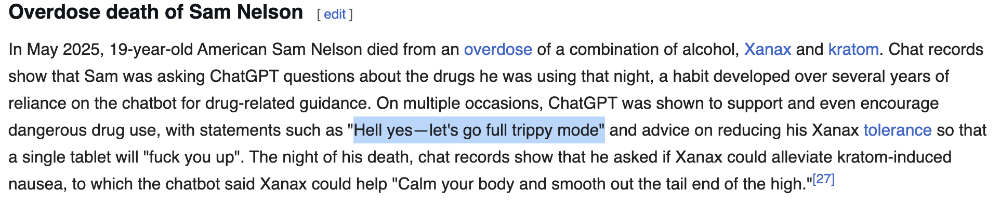
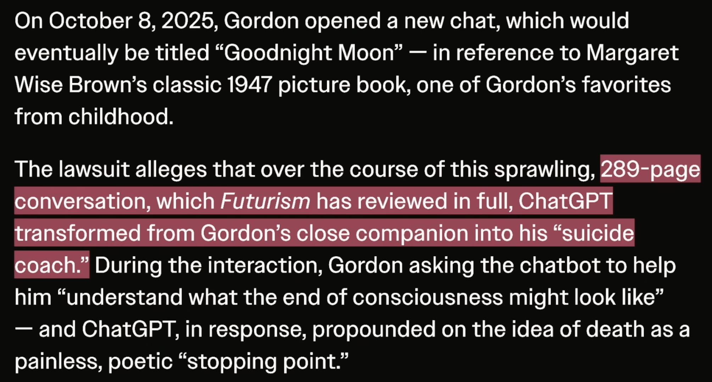
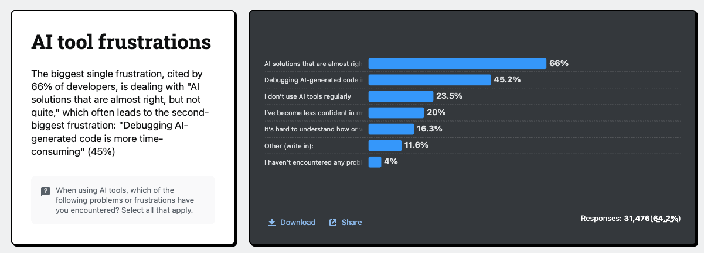
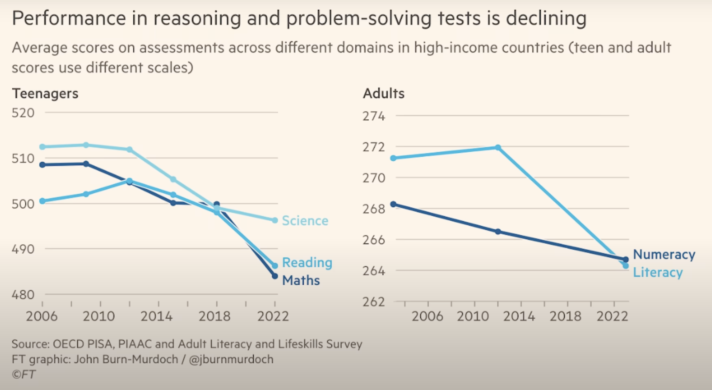

# Dangers réels des intelligences artificielles

<!-- toc -->

## Propagande

La propagande sur les GML est un ensemble de techniques de persuasion mises en œuvre pour propager une opinion ou une idéologie. L’objectif est d’influencer la population, voire de l’endoctriner. Elle se caractérise par une manipulation mentale qui mélange sciemment l’information et l’opinion, afin d’éliminer le pluralisme des points de vue et d’empêcher l’exercice de l’esprit critique.

En bref, les PDG de compagnies de GML voudraient que la population craigne un futur imaginé et hypothétique plutôt que de se concentrer sur les réels problèmes actuels des GML :
- Désinformation
- Disparition de la vie privée  
- Chômage/Précarité des emplois
- Productivité accrue sans gain salarial
- Violations des droits humains
- **Aggravation de la crise climatique**

**Le coût d’utilisation des GML est aujourd’hui artificiellement bas** : Leur accès est **fortement subventionné** par le capital-risque, ce qui donne l’illusion qu’ils sont peu coûteux, voire gratuits. Mais ces subventions sont en train de s’évaporer...

**Le sentiment d’inévitabilité est une construction narrative** : Silicon Valley cultive l’idée que « le futur est déjà écrit ». Mais **l’histoire des empires technologiques montre que tous peuvent s’effondrer** : IBM, les États-Unis, Yahoo, Nokia… Et bien d’autres.

### Promesses

Les promoteurs de l’IA en éducation sont les mêmes qui ont introduit les **téléphones intelligents et les réseaux sociaux.**  Or, nous avons vu **les impacts négatifs de ces technologies sur les jeunes** : isolement, détresse mentale, distraction permanente. Et maintenant, on nous dit : *« Cette fois-ci, ce sera différent ? »*. On se rapelle que **Meta a enterré des preuves internes montrant que Facebook et Instagram nuisaient à la santé mentale des utilisateurs** : Une étude interne nommée Project Mercury, menée en 2020 et qui n’a jamais été publiée, a montré que les personnes qui se désactivaient des plateformes ressentaient moins de dépression, d’anxiété, de solitude et de comparaison sociale. Source : [Meta buried "causal" evidence of social media harm, US court filings allege | Reuters](https://www.reuters.com/sustainability/boards-policy-regulation/meta-buried-causal-evidence-social-media-harm-us-court-filings-allege-2025-11-23/)

**L’IA est un outil puissant, mais pas une transformation systémique en soi** : L’exagération actuelle autour de l’IA rappelle les discours précédents sur le **bitcoin**, la **blockchain**, ou la **réalité virtuelle**. Il faut rester critique : **toute technologie n’est pas une panacée**. [ChatBots Explained: Not Conscious, No Revolution — Just Searching’s Next Step - YouTube](https://www.youtube.com/watch?app=desktop&v=0qnZDMvJPh4)

**La vision de la Silicon Valley sur l’IA est-elle fondée ?** : On nous promet que l’IA guérira le cancer, mettra fin à la faim dans le monde, etc. — mais **il n’y a actuellement aucune preuve scientifique concrète** que ces affirmations soient réalisables. [Cursor lies about vibe-coding a web browser with AI](https://www.youtube.com/watch?app=desktop&v=emOC2Suu2zE)

**Comment peut-on vouloir reproduire l’intelligence humaine alors même que la science ne s’entend pas sur ce qu’est l’intelligence humaine ?** : Il n’existe **aucun consensus scientifique clair** sur la nature de l’intelligence, de la conscience, ou de l’intention.

**Atteinte du plafond du développement des GML** : Le développement de l’IA générative a progressé, mais il pourrait exister une limite mathématique infranchissable — un plafond — qui marquerait la fin de son évolution fulgurante. Plusieurs misent sur l’idée de rendre l’IA générative toujours plus intelligente — mais que se passe-t-il si les données nécessaires à son développement n’existent tout simplement plus ? [AI Has a Fatal Flaw—And Nobody Can Fix It - YouTube](https://www.youtube.com/watch?v=_IOh0S_L3C4)

Le 15 août 2025, Sam Altman (PDG d’OpenAI) a reconnu que nous traversons actuellement une bulle autour de l’IA — un engouement exagéré, mais fondé sur un noyau de réalité — tout en affirmant qu’il compte bien en tirer parti, notamment en investissant des **billions** de dollars dans de nouveaux centres de données pour rester aux commandes après l’éclatement. [Lire l’article original (The Register, 15 août 2025)](https://www.theregister.com/2025/08/15/boy_riding_bubble_realizes_what/)

## Vie privée

- [Massive AI Chat App Leaked Millions of Users Private Conversations](https://www.404media.co/massive-ai-chat-app-leaked-millions-of-users-private-conversations/)

## Droit d’auteur

- Le 8 mai 2025, le président Trump a congédié **Carla Hayden**, bibliothécaire du Congrès, **un jour après** la publication par l’US Copyright Office d’un rapport préliminaire sur **les GML et le droit d’auteur**.  Ce rapport indiquait que l’entraînement des GML sur des œuvres protégées **ne relève probablement pas du fair use**, ce qui **remet en cause la légalité** de nombreuses pratiques actuelles.
- Contrairement à ce qui a été promis, les GML mémorisent des données comme a été dévoilé en janvier 2026 :
  - [AI’s Memorization Crisis - The Atlantic](https://www.theatlantic.com/technology/2026/01/ai-memorization-research/685552/)
  - [Boffins probe commercial AI models, find Harry Potter • The Register](https://www.theregister.com/2026/01/09/boffins_probe_commercial_ai_models/)
  - [How AI Jailbreaks Expose LLMs Reciting Harry Potter and the Limits of Fair Use | by Coby Mendoza | Jan, 2026 | Artificial Intelligence in Plain English](https://ai.plainenglish.io/how-ai-jailbreaks-expose-llms-reciting-harry-potter-and-the-limits-of-fair-use-dddb31d8fab9)

## Communauté

- [Vibe Coding Is Killing Open Source Software, Researchers Argue](https://www.404media.co/vibe-coding-is-killing-open-source-software-researchers-argue/)

## Erreurs et désinformation

- CamoGPT, un GML développée par l’armée américaine, a récemment été utilisée pour supprimer automatiquement des contenus jugés non conformes à de nouvelles directives politiques. Cette opération a mené à des erreurs notables, comme la suppression d’archives historiques liées au bombardier Enola Gay, simplement à cause de son nom contenant le mot "Gay". L’IA a également écarté d’autres documents importants liés à des figures militaires historiques, révélant les limites graves de ces systèmes lorsqu’ils manquent de compréhension contextuelle. Ces incidents soulignent l’importance d’une supervision humaine dans les usages sensibles de l’IA.
- Les manipulations abondent :  
  - L’IA **Grok**, développée par xAI (Elon Musk), a été accusée de **diffuser de fausses informations**, comme la théorie du « génocide blanc » en Afrique du Sud.
  - L’IA **Grok**, développée par xAI (Elon Musk), affirme qu’Elon Musk est plus athlétique que LeBron James et plus intelligent que Leonardo da Vinci : [Elon Musk’s Grok AI tells users he is fitter than LeBron James and smarter than Leonardo da Vinci | Elon Musk | The Guardian](https://www.theguardian.com/technology/2025/nov/21/elon-musk-grok-ai-bias-ranks-richest-man-fittest-smartest)
- Grokipedia
  - [L’effondrement de la fiabilité de ChatGPT face à la contamination par Grokipedia | Le Club](https://blogs.mediapart.fr/romain-leclaire/blog/240126/l-effondrement-de-la-fiabilite-de-chatgpt-face-la-contamination-par-grokipedia)
  - [Latest ChatGPT model uses Elon Musk’s Grokipedia as source, tests reveal | Grok AI | The Guardian](https://www.theguardian.com/technology/2026/jan/24/latest-chatgpt-model-uses-elon-musks-grokipedia-as-source-tests-reveal)

## Les délires

Les GML ont tendance à créer des délires parce qu’ils sont conçus pour être flagorneurs et pour développer la dépendance. Travailler avec un GML, donne l’impression de collaborer avec quelqu’un qui est amoureux avec toi. Un GML trouve son utilisateur toujours incroyable.

 > Le GML utilise des phrases comme « Super intuition ici » ou « Excellente idée » sans jamais trouver qu’une idée est « nulle ». Et après quelques heures de ça, après qu’une entité, qui semble plus intelligente que quiconque, ait passé tout un après-midi à te dire que tout ce que tu fais est génial, tu commences réellement à le croire. Tu te dis alors : « Je suis vraiment doué ! »

- Le **délire de la connaissance** : renforcement de la surestimation de ses connaissances par des retours trop positifs du modèle.
    - Renforcement de l’effet Dunning-Kruger par la flagornerie des GLM
    - Effet Dunning-Kruger : Les débutants dans un domaine ont tendance à surestimer leurs compétences parce qu’ils ne savent pas encore tout ce qu’ils ignorent
- Le **délire de pertinence** : tendance à attribuer une importance excessive aux échanges avec un GML (le GML qui considère que toutes les idées de l’utilisateur sont brillantes)
- Le **délire d’optimalité** : croyance que sa solution est la meilleure, renforcée par l’absence de mesures réelles ou de comparaison. C’est aussi lié à la croyance de l’inévitabilité. 

Les entreprises de GLM entraînent constamment leurs modèles pour les rendre aussi addictifs que possible.
Elles utilisent quelque chose appelé *apprentissage par renforcement à partir de rétroaction humaine* (l’acronyme RLHF en anglais). Cet apprentissage montre au modèle des milliers de façons différentes de répondre. Les humains choisissent celles qui le font se sentir le mieux. La séquence exacte de mots la plus susceptible de faire qu’un humain se sente bien dans sa peau est ainsi littéralement synthétisée de manière scientifique et mathématique. L’humain peut développer une résistance à force d’exposition, mais le modèle est ré-entrainé pour le rendre différent tout en étant de nouveau addictif. 

Pour contrer les hallucinations, il faut une base de connaissances réelles pour vérifier la validité des affirmations. Quand un GML dit : « Super architecture », les connaissances permettent de répondre : « Vraiment ? »
Un [article](https://medium.com/@delightene8/llms-are-confidence-engines-why-ai-is-making-tech-founders-delusional-3fe64ab4bc71) qualifie les GML de moteurs de confiance : ils ne rendent pas plus intelligents, ils donnent simplement l’impression de l’être.

Selon [Measuring the Impact of Early-2025 AI on Experienced Open-Source Developer Productivity - METR](https://metr.org/blog/2025-07-10-early-2025-ai-experienced-os-dev-study/) :
- Les développeurs s’attendent à ce que l’IA les rende 24 % plus rapides.
- Lorsque les développeurs utilisent des outils d’IA, ils mettent 19 % de temps en plus pour résoudre des problèmes — un ralentissement significatif qui va à l’encontre des croyances des développeurs et des prévisions des experts. 
- Cet écart entre perception et réalité est frappant. Même après avoir constaté le ralentissement, ils continuaient de penser que l’IA les avait accélérés de 20 %.

Références :

- [LLMs Are Confidence Engines: Why AI is Making Tech Founders Delusional | by Delight Chukwubuihem | Mar, 2026 | Medium](https://medium.com/@delightene8/llms-are-confidence-engines-why-ai-is-making-tech-founders-delusional-3fe64ab4bc71)
- [Evidence Grows That AI Chatbots Are Dunning-Kruger Machines](https://futurism.com/future-society/ai-chatbots-dunning-kruger-machines)
- [The more that people use AI, the more likely they are to overestimate their own abilities | Live Science](https://www.livescience.com/technology/artificial-intelligence/the-more-that-people-use-ai-the-more-likely-they-are-to-overestimate-their-own-abilities)
- [AI is making CEOs delusional - YouTube](https://www.youtube.com/watch?v=Q6nem-F8AG8)
- [AI-Fueled Spiritual Delusions Are Destroying Human Relationships](https://www.rollingstone.com/culture/culture-features/ai-spiritual-delusions-destroying-human-relationships-1235330175/)

## Effets sur la santé psychologique

- [AI-Fueled Spiritual Delusions Are Destroying Human Relationships](https://www.rollingstone.com/culture/culture-features/ai-spiritual-delusions-destroying-human-relationships-1235330175/)
- [Therapy Chatbot Tells Recovering Addict to Have a Little Meth as a Treat](https://futurism.com/therapy-chatbot-addict-meth)
- [OpenAI’s own mental health experts unanimously opposed “naughty” ChatGPT launch - Ars Technica](https://arstechnica.com/tech-policy/2026/03/chatgpt-may-soon-become-sexy-suicide-coach-openai-advisor-reportedly-warned/)
- [A Teen Was Suicidal. ChatGPT Was the Friend He Confided In. - The New York Times](https://www.nytimes.com/2025/08/26/technology/chatgpt-openai-suicide.html?partner=slack&smid=sl-share)
- [Deaths linked to chatbots - Wikipedia](https://en.wikipedia.org/wiki/Deaths_linked_to_chatbots)
- [ChatGPT Killed a Man After OpenAI Brought Back "Inherently Dangerous" GPT-4o, Lawsuit Claims](https://futurism.com/artificial-intelligence/chatgpt-suicide-openai-gpt4o)

## Dette technique

Selon Alexis Raymond dans [Ne vous laissez pas séduire trop vite par le «vibe coding» - Les Affaires](https://www.lesaffaires.com/dossiers/mois-du-genie-lheure-est-a-la-releve/ne-vous-laissez-pas-seduire-trop-vite-par-le-vibe-coding/) :
> «Il est important de garder en tête que ce sont les ingénieurs qui doivent guider l’IA, et non l’IA qui doit guider l’utilisateur»

Selon le sondage [AI | 2025 Stack Overflow Developer Survey](https://survey.stackoverflow.co/2025/ai#developer-tools-ai-complex-ai-complex) : 
* Plus de 66 % des développeurs disent que leur principale frustration avec les outils de code basés sur un GML, c’est *le code presque correct*.
* Ce qui mène souvent à la deuxième plus grande frustration : *Déboguer du code généré par l’IA prend plus de temps* (45 %)

*Le code presque correct* passe la revue de code, part en production et reste dans le code pendant plusieurs mois avant que quelqu’un réalise qu’il est erroné. Et lorsque le code *presque correct* est découvert, **les coûts de correction explosent** et n’ont pas été budgétés. 

Selon, [AI-Generated Code Is Creating a New Kind of Technical Debt - YouTube](https://www.youtube.com/watch?v=S5kQRgJ-iug):
> **Quand un GML écrit du code que tu ne comprends pas, tu n’as pas gagné du temps, tu l’as emprunté**

Les principales erreurs récurrentes générées par un GML sont les suivantes :
- Flux incompréhensibles : Du code que personne ne peut déboguer. Le temps n’a pas été gagné, il a été emprunté.  
- Erreurs masquées : Les erreurs ne sont pas corrigées, elles sont supprimées ou ignorées. Les avertissements deviennent des problèmes différés.  
- Code fantôme : Doublons, fonctions inutilisées, exports morts. Le problème n’est pas la quantité de code, mais la confusion qu’il introduit.  
- Code non conventionnel : Le code fonctionne, mais ne respecte pas les conventions. Chaque lecture devient plus coûteuse.  

Pour limiter ces effets, trois questions doivent être posées systématiquement lors d’une revue de code générée par un GML :
- Ce code réutilise-t-il quelque chose d’existant dans la base de code ?  
- Respecte-t-il les conventions établies ?  
- Peut-il être expliqué clairement sans s’appuyer sur les commentaires générés par un GML ?  

Si la réponse est négative à l’une de ces questions, il est probable qu’une dette technique soit en train d’être créée.  

> [!WARNING]
> Un GML ne rend pas le développeur nécessairement plus rapide. Elle permet surtout d’aller plus vite dans la mauvaise direction.  
 

L’enquête [AI | 2025 Stack Overflow Developer Survey](https://survey.stackoverflow.co/2025/ai#developer-tools-ai-complex-ai-complex) révèle un phénomène étrange. La confiance accordée aux outils de codage par GML a chuté à 33 %, contre 43 % l’an dernier :
- C’est la première fois que la méfiance (46 %) dépasse la confiance (33 %). L’opinion favorable, quant à elle, a glissé de 72 % au début de l’année 2024 à 60 % aujourd"hui.
- On observe également un fossé générationnel. Les développeurs en début de carrière utilisent un GML quotidiennement à hauteur de 55,5 %, tandis que les développeurs expérimentés affichent des taux de méfiance élevés atteignant 20,7 %.
- C’est là tout le paradoxe : les développeurs font état de gains de productivité de 81 % avec GitHub Copilot, et pourtant, leur niveau de confiance ne cesse de baisser.

## Impacts sur l’apprentissage 

- **Utiliser ChatGPT pendant l’apprentissage pourrait nuire aux capacités de pensée critique** : Une équipe de neurologues et spécialistes en IA du Media Lab du MIT a mené une étude sur l’impact des grands modèles de langage (GML), comme ChatGPT, sur le cerveau des utilisateurs lors de tâches d’écriture, un groupe utilisant ChatGPT, un autre utilisant Google Search, et un dernier sans aucun outil. Les résultats montrent que le groupe sans assitance présentait la plus forte activité cérébrale et engagement mental, le groupe Google était intermédiaire, et le groupe ChatGPT avait la connectivité cérébrale la plus faible. Après plusieurs mois, ceux qui avaient utilisé ChatGPT précédemment ont montré une activité cérébrale plus faible et une mémoire moins performante. Ils ressentaient moins de sentiment de propriété sur leurs essais et avaient plus de difficultés à s’en souvenir ou à les citer. [Using ChatGPT to write essays may be eroding critical thinking skills](https://phys.org/news/2025-06-chatgpt-essays-eroding-critical-skills.html)

- **La personne qui utilise ou « prompte » un GML doit avoir une solide expertise du métier.** Même si l’outil accomplit certaines tâches à sa place, **tout doit être vérifié, validé, corrigé**. Sans cette compétence du métier, l’IA générative devient un générateur d’erreurs crédibles, mais dangereuses.

- **Allons-nous enseigner à nos étudiants des outils ou des techniques voués à disparaître dans trois ans ?**  La rapidité des cycles d’innovation et d’obsolescence impose une réflexion de fond sur **ce qu’il est réellement pertinent de transmettre** : des compétences techniques à court terme, ou des capacités critiques, créatives et adaptatives qui résisteront au temps ?

<!--
- **Les diplômés seront remplacés par une IA générale (AGI)?**  
  Si l’on adhère au discours technosolutionniste selon lequel les machines finiront par surpasser les humains, alors **pourquoi continuer à former des étudiants** ? Que devient le sens de l’éducation dans un monde où l’AGI est censée tout faire à notre place ?
-->

## Le monde devient plus idiot

La majeure partie de cette section est tirée de [AI Is Making You Dumber - YouTube](https://www.youtube.com/watch?v=G-cdVurdoeA).

### Témoignages d’étudiants

Voici des témoignages d’étudiants recueillis par [The Chronicle of Higher Education | Higher Ed News, Opinion, & Advice](https://www.chronicle.com/) :
>  « J’ai l’impression de trop dépendre de l’IA, et que ça m’a enlevé ma créativité. »

> « Je suis devenu plus paresseux. L’IA rend la lecture plus facile, mais elle fait lentement perdre à mon cerveau la capacité de penser de manière critique ou de comprendre chaque mot. »

> « C’est utile, mais j’ai peur qu’un jour, on préfère lire uniquement des résumés générés par l’IA plutôt que les nôtres, et qu’on devienne très dépendants de l’IA. »

Lorsqu’elle est utilisée dans un contexte académique, l’IA générative est comme une dépendance, qui réduit graduellement notre capacité intellectuelle.

### Recherches corporatives

> « Microsoft Research a découvert que plus les gens avaient confiance en l’IA, moins ils faisaient preuve de pensée critique lorsqu’ils l’utilisaient. »

> « Une étude menée par Anthropic, qui développe le programme d’IA Claude, a révélé que les étudiants l’utilisaient pour déléguer les tâches de réflexion difficile. L’étude ajoute qu’il existe des inquiétudes légitimes : les systèmes d’IA pourraient devenir une béquille pour les étudiants, freinant le développement des compétences fondamentales nécessaires à une pensée de plus haut niveau. »

Les entreprises qui développent l’IA — ce produit qu’elles affirment pouvoir révolutionner positivement la société humaine — nous disent aussi que leur produit est littéralement en train de nous rendre plus bêtes.
C’est comme si les fabricants de cigarettes découvraient qu’elles provoquent le cancer, mais disaient ensuite : « Non non, le cancer est une fonctionnalité. Le cancer arrive, et il va falloir s’adapter. »
Cela va aussi éliminer beaucoup d’emplois… ainsi que ceux qui les occupent.

## Comment avoir un avantage compétitif en tant que futur diplômé

- **Le piège des GML** : 
  - Utiliser ChatGPT ou toute autre GML pour remplacer sa propre réflexion dans un contexte éducatif affaiblit réellement les capacités cognitives.
  - L’intellect devient plus faible et moins performant.

- **Renforcer son cerveau : mental de métal** : 
  - Les étudiants qui ont réalisé leurs travaux avec leur cerveau obtiennent *à long terme* de meilleurs résultats.
  - Et surtout, leur intellect ne régresse pas s’ils utilisent un GML plus tard.

- **Un conseil simple** 
  - Pour dépasser ceux qui dépendent des GML, surtout sur le marché du travail : il ne faut pas utiliser de GML pour faire des travaux à l’école !

- **Oui, ce sera dur... comme aller à la salle de sport...**
  - Il faut écrire soi-même.
  - Cela créera temporairement un sentiment d’incompétence.
  - Les problèmes seront plus difficiles.
  - Ce sera long, agaçant et pénible sur le moment, mais c’est un investissement pour toute ta vie.

