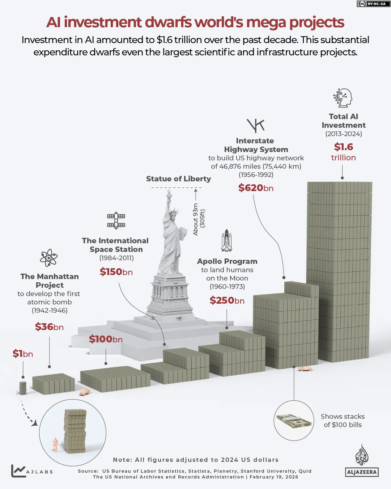
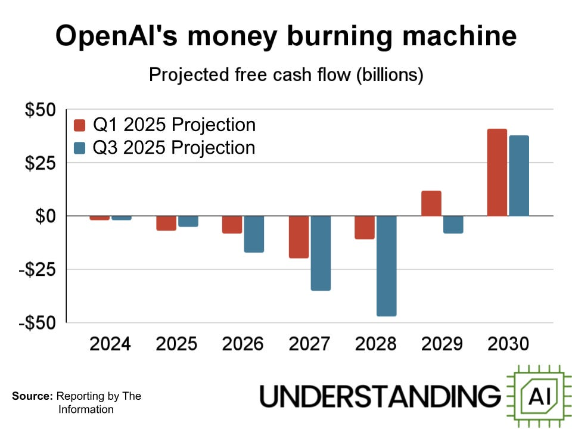
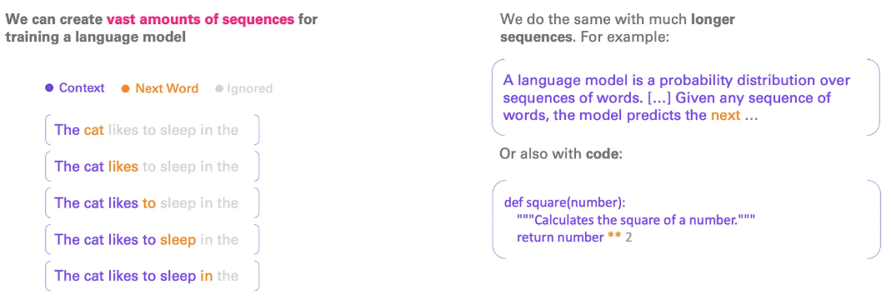
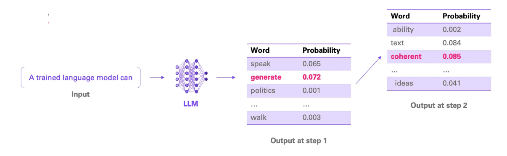
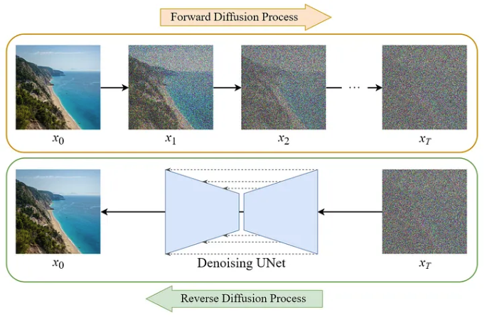
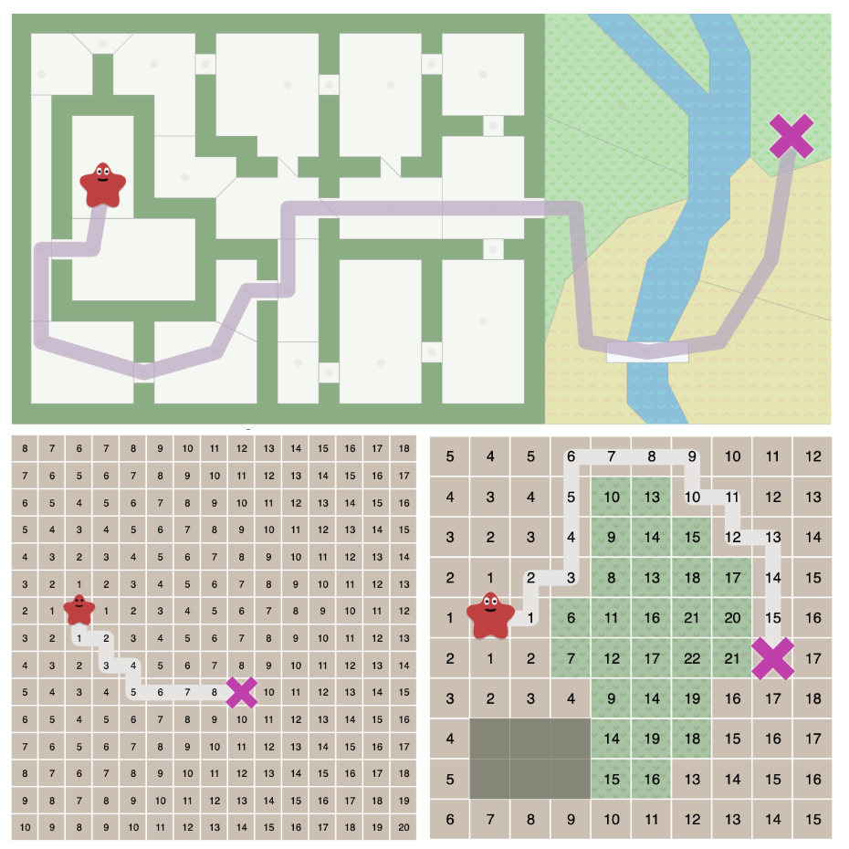
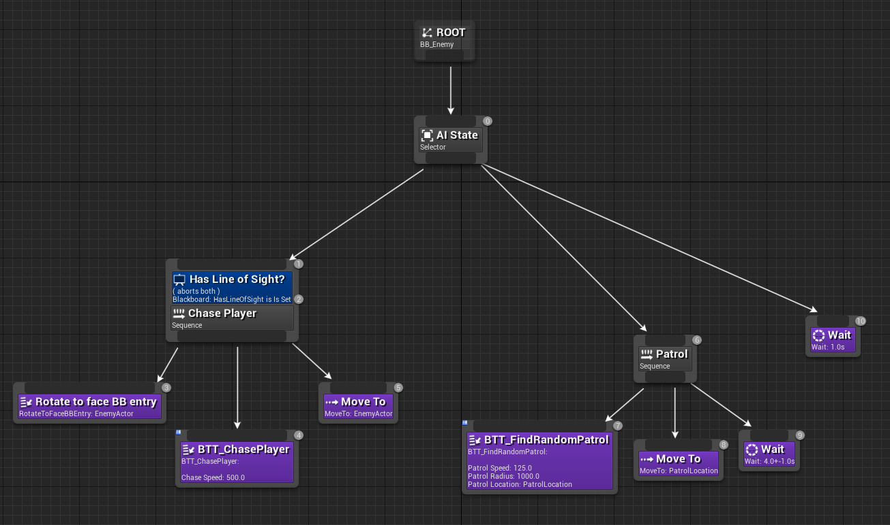

# Types d’intelligence artificielle

<!-- toc -->

## La confusion autour du terme «IA»

> [!WARNING]
> Le terme « IA », sans qualificatif, est un **buzzword** marketing qui embrouille le public. 
> Il existe en réalité plusieurs types d’IA différents. 
> Dans aucun cas, le système est réellement intelligent ou conscient.


## Compétences humaines vs machines

| **Compétences**                                           | **Humains** | **Machines** |
|------------------------------|-------|---------|
| Opérations mathématiques                                  |             | ✅              |
| Mémoire et rappel                                         |             | ✅              |
| Raisonnement général (tests de QI)                        |             | ✅              |
| Programmation de base                                     |             | ✅              |
| Bon sens                                                  | ✅          |                 |
| Créativité                                                | ✅          |                 |
| Prise de décision                   					    | ✅          |                 |


## Grand modèle de langage (GML)

Le GML sont constitués à partir de réseaux neuronaux. 
**Les systèmes neuronaux fonctionnent comme un moteur de reconnaissance de motifs.**  
Ils ne comprennent pas le sens, mais identifient des régularités statistiques dans les données d’entraînement pour prédire la suite la plus probable.

Un GML, c’est un très bon imitateur qui peut parler comme un philosophe, un ingénieur ou un poète — mais qui ne comprend pas vraiment ce qu’il dit. L’humain y projette des intentions ou des capacités qu’il n’a pas réellement.

> [!NOTE]
> Contrairement à ce que l’on pourrait croire, les technologies d’IA ne sont pas récentes. Elles sont en développement depuis les années 1950.


Capacité d’un GML pour jouer à un jeu :

| Type de jeu                               | Performance d’un LLM | Remarques                                                               |
| --------------------- | ------------- | ------------------------------------ |
| **Échecs, Go, Shōgi**                     | Faible                  | Suit mal l’état du jeu, oublie les règles ou fait des coups illégaux    |
| **Tic-Tac-Toe**                 | Bonne                   | Jeu simple, facile à suivre en texte                                    |
| **Jeux de stratégie (Catan, Risk, etc.)** | 🤔 Inconstante            | Possible sur quelques tours, mais perd le fil rapidement. Peut simuler des dialogues ou des choix, mais sans planification réelle |

### Financement





### Dangers

Il existe de nombreux [dangers](../dangers/) liés à l'utilisation des GML.


### Caractéristiques principales

- **Architecture** : Réseaux de neurones profonds ; *transformers*
- **Données d’entraînement** : Corpus textuels massifs (Internet, livres, articles)
- **Mécanisme** : Reconnaissance de motifs
- **Sorties** : Texte, code, traduction, résumé, dialogue


### Avantages

✅ Large éventail de tâches dans plusieurs domaines  

### Limites et risques

❌ Risques de biais, d’erreurs ou de dérives  
❌ Impact environnemental très élevé : modèles massifs, infrastructure lourde  
❌ Moins durable, dépendance aux géants du cloud  
❌ Très élevés coûts : en données, calcul, maintenance  

### Fonctionnement






## Générateur d’image

Le générateur apprend à reconstruire des images en partant d’un bruit aléatoire. Il utilise les motifs appris durant l’entraînement pour dé-bruiter progressivement jusqu’à obtenir une image cohérente correspondant au prompt texte.

Pour entraîner Stable Diffusion, du bruit est progressivement ajouté à des images réelles à des niveaux croissants, et le modèle apprend à prédire ce bruit en fonction de l’image bruitée, du niveau de bruit et d’une description textuelle. 

Lors de la génération d’une image, le modèle commence par un bruit aléatoire et retire itérativement les étapes de bruit prédites, guidé par l’invite textuelle, jusqu’à ce qu’une image claire émerge.




### Caractéristiques principales

- **Architecture** : Réseaux de neurones profonds (diffusion models, GANs, transformers)
- **Données d’entraînement** : Millions d’images avec descriptions textuelles associées
- **Mécanisme** : Reconnaissance de motifs visuels et génération progressive
- **Sorties** : Images, illustrations, photographies synthétiques


### Avantages

✅ Création rapide d’illustrations originales   
✅ Grande variété de styles possible  

### Limites et risques

❌ Problèmes de droits d’auteur sur les données d’entraînement  
❌ Difficulté à contrôler précisément les détails  
❌ Risque de deepfakes et désinformation visuelle  
❌ Impact environnemental similaire aux GML  


##  IA pour jeux de stratégie (Échecs, Go, etc)


L’IA de stratégie fonctionne comme une **base de données de toutes les possibilités** combinée à une simulation des alternatives. Elle calcule systématiquement les coupes futures ou consulte une bibliothèque exhaustive de positions connues pour choisir le mouvement optimal.

Ces systèmes ont exploré pratiquement toutes les parties possibles dans leurs environnements fermés. Pour les jeux aux règles simples comme les échecs, le nombre de combinaisons reste gérable par force brute assistée. Pour des jeux plus complexes comme le Go, ils combinent recherche arborescente et apprentissage profond pour évaluer les positions sans avoir une mémoire de toutes les parties.

Il existe deux approches principales :

- **Base de données exhaustive** : Stockage de millions/milliards de positions déjà jouées avec leur issue connue. Quand une position apparaît, l’IA consulte directement cette base.
- **Simulation des alternatives** : Arbres de décision où l’algorithme explore virtuellement chaque branche possible, évalue les issues potentielles, et sélectionne la meilleure trajectoire (Minimax, MCTS).

Les **algorithmes principaux** sont Minimax, Monte Carlo Tree Search (MCTS). Une approche plus moderne consiste à combiner Monte Carlo Tree Search avec un réseaux de neurones profonds (comme dans AlphaGo).

Exemples emblématiques :

| Système | Jeu | Année | Organisme |
|-----|---|----|------|
| Deep Blue | Échecs | 1997 | IBM |
| AlphaGo | Go | 2016 | DeepMind |
| AlphaZero | Échecs/Go/Shogi | 2017 | DeepMind |
| Pluribus | Poker | 2019 | CMU/Facebook |

### Avantages

✅ Niveau super-humain dans son domaine spécialisé  
✅ Résultats reproductibles et traçables  
✅ Environnement contrôlé et prédictible  

### Limites

❌ Ne fonctionne PAS hors du domaine spécifique  


## IA traditionnelle dans les jeux vidéo 

L’IA de jeu vidéo est **scriptée par les concepteurs**. Chaque comportement est prémédité et codé explicitement, sans aucune capacité d’apprentissage autonome.

L’IA de jeu vidéo n’est **pas de l’apprentissage**. Chaque comportement est scripté et paramétré par les concepteurs. Il n’y a pas d’adaptation autonome.

Techniques utilisées :

| Technique | Usage |
|------|----|
| Machines à états finis | Comportements de PNJ simples |
| Arbres de comportement (Behavior Trees) | Hiérarchie d’actions conditionnelles  |
| Pathfinding (A*) | Navigation et déplacement |





Exemple d’un arbre de comportement en code (tiré de [⚙️ Tech Breakdown: AI with Finite State Machines - Little Polygon Game Dev Blog](https://blog.littlepolygon.com/posts/fsm/)) : 
```csharp
uint32 SomeEnemy::HandleEvent( const FSMEvent& Event ) override
{
	switch( Event.MakeSwitch(State) )
	{
	case FSM_ID( STANDING_STILL, ENTER ):
	{
		/* code for entering the standing-still state */
		break;
	}
	case FSM_ID( STANDING_STILL, UPDATE ):
	{
		/* code for updating the standing-still state */
		break;
	}
	case FSM_ID( STANDING_STILL, EXIT ):
	{
		/* code for leaving the standing-still state */
		break;
	}
	case FSM_ID( MOVING, ENTER ):
	{
		/* code for entering the moving state */
		break;
	}
	case FSM_ID( MOVING, UPDATE ):
	{
		/* code for updating the moving state */
		break;
	}
	case FSM_ID( MOVING, EXIT ):
	{
		/* code for leaving the moving state */
		break;
	}
	default:
		break;
	}

	return Super::HandleEvent( Event );
}
```

### Avantages

✅ Complètement transparente (code accessible)  
✅ Prévisible et contrôlable ; **maintenir le contrôle** des développeurs sur le gameplay  
✅ Légère en ressources computationnelles; **assurer la performance temps réel** (60 FPS+)  
✅ **Garantir la reproductibilité** du comportement  

### Limites

❌ Pas d’apprentissage autonome  
❌ Comportement scripté, non adaptatif  
❌ Dépendante entièrement des développeurs  


## IA générale (AGI) hypothétique

L’**IA générale** désigne une intelligence artificielle hypothétique capable de :
- Remplacer un humain
- Comprendre, apprendre et appliquer ses connaissances à travers tous les domaines
- S’adapter contextuellement
- Prendre des décisions autonomes dans des situations inédites


> [!IMPORTANT]
> Contrairement à la confusion véhiculée par le marketing techno-solutionniste, une IA générative (GML) **ne peut pas évoluer** en IA générale (AGI). Ce sont deux technologies fondamentalement distinctes, tant par leur architecture que par leur fonctionnement.
> **Cette technologie n’existe pas aujourd"hui.**  Elle reste de la science-fiction.

## Tableau récapitulatif

| Critère | GML (LLM) | Générateur d’images | IA pour Échecs/Go | IA jeu vidéo | IA Générale |
|-----|------|-------|----------|-------|-------|
| **Spécialité** | Texte, langage naturel | Générer des images | Un jeu **spécifique** | Comportements de PNJ | Remplacer un humain |
| **Fonctionnement** | Reconnaissance de motifs | Reconstitue une image à partir de bruit (diffusion) | Simulation des coups possibles | Scripts de concepteurs | — |
| **Apprentissage** | Données textuelles massives | Corpus d’images + débruitage itératif | Auto-play / renforcement | Scripté par humains | Hypothétique |
| **Flexibilité** | Multi-tâches (superficiel) | Une tâche (visuel), qualité variable | Une tâche, niveau super-humain | Tâche unique, limitée | Illimitée (si existait) |
| **Transparence** | Boîte noire | Boîte noire | Partiellement traçable | Complètement transparente | Inconnue |
| **Conscience** | Aucune | Aucune | Aucune | Aucune | Hypothétique |
| **État** | Disponible | Disponible | Disponible | Disponible | N’existe pas |
| **Exemples** | ChatGPT, Claude | Stable Diffusion, DALL-E 3, Midjourney | AlphaGo, Deep Blue | A*, FSM | N’existe pas |
| **Architecture** | Transformers | Diffusion Models / GANs | MCTS + Réseaux neuronaux | FSM, Behavior Trees | — |