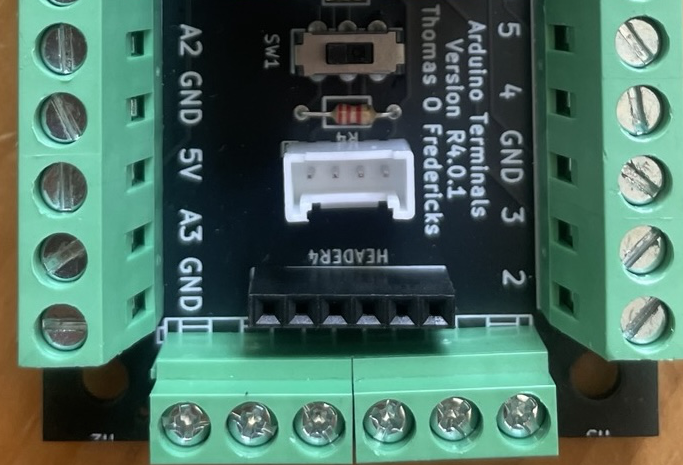
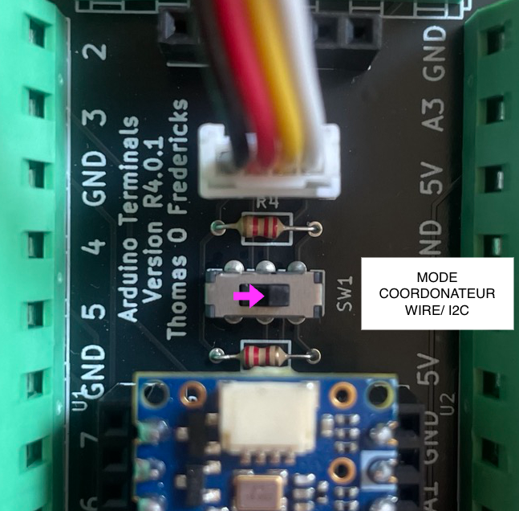
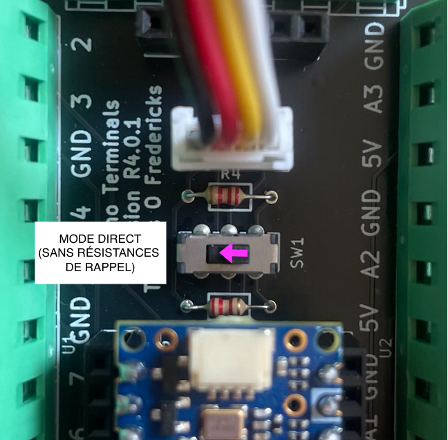
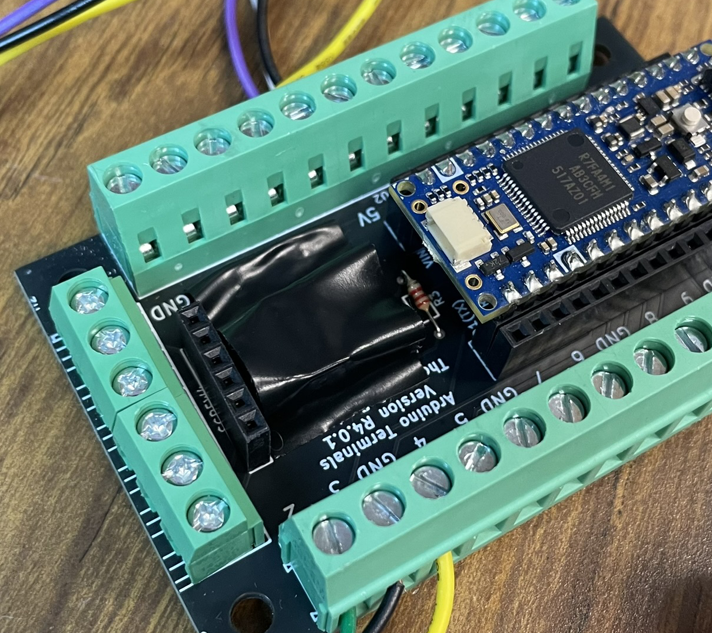
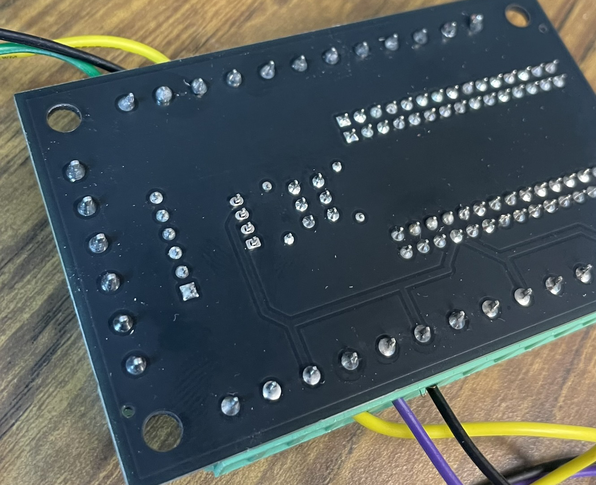
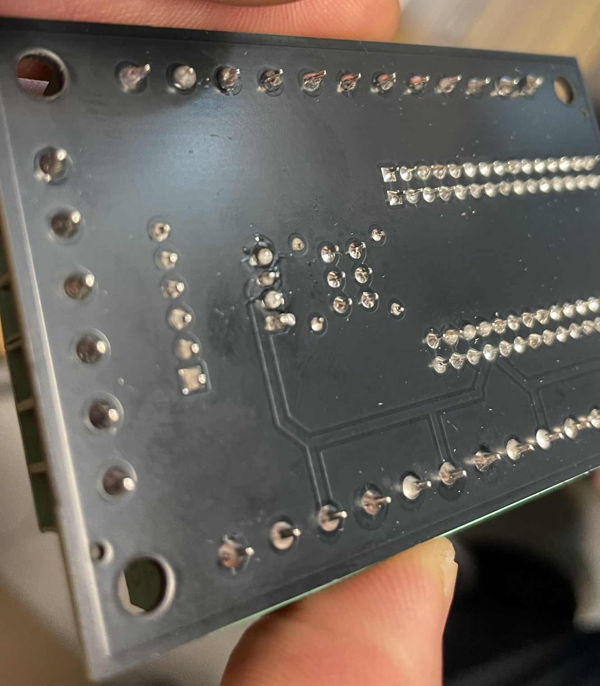
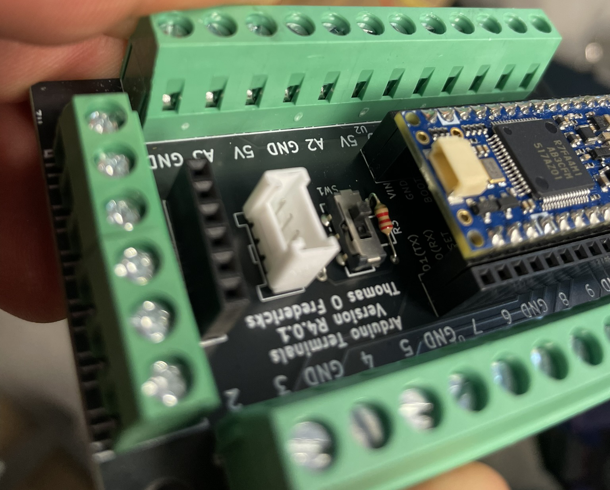

# Arduino Terminals : connecteur Grove pour I2C/Wire

<!-- toc -->

## Introduction

Le connecteur Grove permet de connecter des périphériques équipés du même connecteur. Il possède 4 points de connexion :
- 1 : GND - couleur noire
- 2 : VCC (5V) - couleur rouge
- 3 : SDA / broche A4 - couleur jaune
- 4 : SCL / broche A5 - couleur blanche

Les broches GND et VCC servent à l’alimentation. Les broches SDA et SCL comme des broches régulières ou pour **l’I2C**.

**L’I2C**. (*Inter-Integrated Circuit*) est un protocole de communication **synchrone série** permettant de faire dialoguer plusieurs périphériques avec le microcontrôleur via seulement **deux fils** :

- **SDA** (*Serial Data*) : ligne de données bidirectionnelle
- **SCL** (*Serial Clock*) : ligne d’horloge générée par le coordonnateur 
- Chaque périphérique possède une **adresse unique** (7 bits, généralement de 0x08 à 0x77), ce qui permet de connecter **plusieurs modules sur le même bus** (jusqu’à 112 théoriquement).
- Un seul **coordonnateur** (l’Arduino) initie et contrôle la communication.

## Activer ou désactiver les résistances de rappel du connecteur Grove

Le connecteur Grove peut être configuré pour utiliser ou pas des résistances de rappel. De façon générale :
- **Activer** les résistances de rappel si Arduino Terminals est le coordonnateur Wire/I2C : glisser le bouton vers le texte `SW1`.
- **Désactiver** les résistances de rappel si les broches sont utilisées en mode direct : glisser le bouton à l’opposé du texte `SW1`.

## Soudure du connecteur Grove

