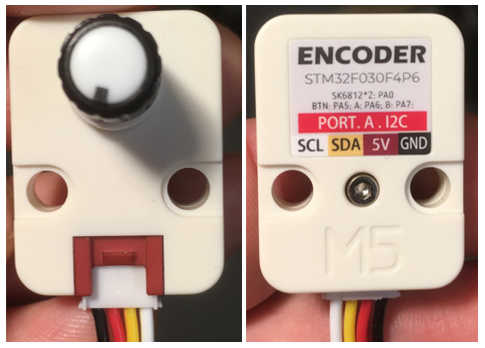

# M5Stack Unit Encoder : Encodeur (capteur) de rotation




## Introduction

Le [M5Stack Unit Encoder](https://docs.m5stack.com/en/unit/encoder) est un encodeur (capteur) de rotation infinie équipé de 2 pixels RGB.

C’est un *Unit* de type **I2C** tel qu’identifié par son connecteur rouge.

> [!WARNING]
> Le M5Stack Unit Encoder doit être connecté à un port I2C identifié par les termes SDA et SCL.

Un cran (*ticks* ou *pulses* en anglais) est l’unité de mesure fondamentale d’un encodeur rotatif. C’est le plus petit mouvement angulaire que l’encodeur peut détecter. Pour chaque cran, le capteur génère une impulsion électrique.

La [bibliothèque thomasfredericks/M5_Encoder](https://github.com/thomasfredericks/M5_Encoder) permet d’interfacer avec ce *Unit*.

## Connexion

Relier le connecteur à un bus **I2C**. Par exemple :
- [Connecteur Grove du Arduino Terminals](/fabrication/arduino/terminals/grove/) en **activant** les résistances de rappel du connecteur Grove pour le mode coordonnateur Wire/I2cC.

> [!WARNING]
> Ne pas oublier d’activer les résistances de rappel du connecteur Grove.

## Installation

Dans le fichier **platformio.ini** ajouter à la section `lib_deps` pour installer la [bibliothèque thomasfredericks/M5_Encoder](https://github.com/thomasfredericks/M5_Encoder) : 

```
lib_deps =
    https://github.com/thomasfredericks/M5_Encoder.git
```

## Initialisation

### Dans l’espace global

Importer et créer une instance de la classe `M5_Encoder` (nommée `monEncodeur` dans l’exemple) :
```cpp
#include <M5_Encoder.h>
M5_Encoder monEncodeur;
```

### Dans setup()

S’assurer que [Wire](/fabrication/arduino/code/wire/) est initialisé : 
```cpp
  Wire.begin();
```

> [!WARNING] 
> Ne pas initialiser `Wire` deux fois dans le code !

Démarrer `monEncodeur` : 
```cpp
  monEncodeur.begin();
```

## Utilisation

### Mise à jour les valeurs de l’encodeur 

Il est nécessaire de mettre à jour les valeurs de l’encodeur **avant de les récupérer**. Il faut ainsi appeler la méthode `monEncodeur.update()` à chaque `loop()` :
```cpp
    monEncodeur.update();     // Mise à jour des valeurs de l’encodeur. 
```

> [!IMPORTANT] 
> Il faut appeler la méthode `update()` de l’encodeur à chaque `loop()`.
> Ne pas faire plusieurs appels à `update()` dans `loop()`. En faire un seul.

**Par exemple**, voici un code de base qui initialise et met à jour l’encodeur :
```cpp
    #include <Arduino.h>
    // ...
    #include <M5_Encoder.h>
    M5_Encoder monEncodeur;
    // ...
    void setup() {
        // ...
        Wire.begin();
        // ...
        monEncodeur.begin();
        // ...
    }
    void loop() {
        // ...
        monEncodeur.update();
        // ...
    }
```

<!-- ### Lecture de la rotation

La rotation représente la somme de tous les crans accumulés par l’encodeur depuis le démarrage du programme :
 - Si l’encodeur est tourné dans le sens horaire, la valeur augmente.
 - Si l’encodeur est tourné dans le sens anti-horaire, la valeur diminue.
  


Une note à propos des valeurs limites : 
 - Si l’encodeur continue de tourner dans le sens horaire, rendue à 32 767, elle tombe à -32 768 à la prochaine rotation
 - Si l’encodeur continue de tourner dans le sens anti-horaire, rendue à -32 768, elle va déborder et passer à sa valeur maximale 32 767 à la prochaine rotation.

Obtenir la rotation accumulée de l’encodeur :
```cpp
    // Lecture de la rotation de l’encodeur
    int valeurEncodeur = monEncodeur.getEncoderRotation();
``` -->

### Lecture du changement de rotation

> [!IMPORTANT] 
> Il faut appeler la méthode `update()` de l’encodeur à chaque `loop()`.
> Ne pas faire plusieurs appels à `update()` dans `loop()`. En faire un seul.

Le changement de rotation est un entier qui peut être :
 - Positif : L’encodeur a tourné de N crans dans le sens horaire depuis le dernier *update*.
 - Négatif : L’encodeur a tourné de N crans dans le sens anti-horaire depuis le dernier *update*.
 - Zéro : L’encodeur est resté immobile.

Obtenir le changement de rotation de l’encodeur :
```cpp
   // Lecture du changement depuis la dernière lecture
    int changementEncodeur = monEncodeur.getEncoderChange();
```

**Par exemple**, pour envoyer un changement de rotation par [MicroOsc](/fabrication/arduino/microosc/) :

```cpp
    #include <Arduino.h>
     // ...
    #include <M5_Encoder.h>
    M5_Encoder monEncodeur;
    // ...
    #include <MicroOscSlip.h>
    MicroOscSlip<128> monOsc(&Serial); 
    // ...
    void setup() {
        // ...
        Wire.begin();
        // ...
        monEncodeur.begin();
        // ...
        Serial.begin(115200);
        // ...
    }
    void loop() {
        // ...
        monEncodeur.update();
        // ...
        int changementEncodeur = monEncodeur.getEncoderChange();
        if ( changementEncodeur != 0 ) // l’encodeur a été tourné 
        {
            monOsc.sendInt("/enc/rot", changementEncodeur);
        }
        // ...
    }
```

Pour récupérer les données et les traiter dans Unity, utiliser [extOSC](/logiciels/unity/osc/extosc/) et un [bind int vers argument float d’une méthode](/logiciels/unity/osc/extosc/bind/int_float/). 

### Lecture du bouton

> [!IMPORTANT] 
> Il faut appeler la méthode `update()` de l’encodeur à chaque `loop()`.
> Ne pas faire plusieurs appels à `update()` dans `loop()`. En faire un seul.

Détecter si le bouton **vient tout juste** d’être **appuyé** (évènement) : 
```cpp
    // ...
    monEncodeur.update();
    // ...  
    if (monEncodeur.wasPressed() ) {
        // ...
    }
```


Détecter si le bouton **vient tout juste** d’être **relâché** (évènement) : 
```cpp
    // ...
    monEncodeur.update();
    // ...  
    if ( monEncodeur.wasReleased() ) {
        // ....
    }
```

**Par exemple**, pour envoyer un changement d’état du bouton par [MicroOsc](/fabrication/arduino/microosc/) :


```cpp
    #include <Arduino.h>
     // ...
    #include <M5_Encoder.h>
    M5_Encoder monEncodeur;
    // ...
    #include <MicroOscSlip.h>
    MicroOscSlip<128> monOsc(&Serial); 
    // ...
    void setup() {
        // ...
        Wire.begin();
        // ...
        monEncodeur.begin();
        // ...
        Serial.begin(115200);
        // ...
    }
    void loop() {
        // ...
        monEncodeur.update();
        // ...
        if ( monEncodeur.wasPressed() ) {
            monOsc.sendInt("/enc/but", 1);
        }
        if ( monEncodeur.wasReleased() ) {
            monOsc.sendInt("/enc/but", 0);
        }
        // ...
    }
```

Pour récupérer les données et les traiter dans Unity, utiliser [extOSC](/logiciels/unity/osc/extosc/) et un [bind int traité dans un if](/logiciels/unity/osc/extosc/bind/int_if/). 

<!-- Obtenir l’état booléen actuel du bouton (flux) :
```cpp
     // Lecture du bouton 
    int etatBouton = monEncodeur.getButtonState();
    // Exemple d’envoi par OSC à l’adresse "/enc/but" de la valeur du bouton : 
    // if ( chronoFluxBouton.hasPassed(20) ) {
    //     chronoFluxBouton.restart();
    //     monOsc.sendInt("/enc/but", etatBouton);
    // }
``` -->

### Écriture des pixels

La couleur de chaque pixel est déterminée avec des valeurs de rouge, vert et bleu entre 0 et 255 inclusivement. Ces valeurs peuvent être trouvées avec un outil tel que le [RGB Color Codes Chart 🎨](https://www.rapidtables.com/web/color/RGB_Color.html).


Les deux pixels :
```cpp
// Changer la couleur des deux pixels simulaténément (les trois valeurs de couleur sont entre 0 et 255 inclusivement)
monEncodeur.setLEDColorBoth( rouge , vert , bleu );
```

Pixel de gauche :
```cpp
// Changer la couleur du pixel de gauche (les trois valeurs de couleur sont entre 0 et 255 inclusivement)
monEncodeur.setLEDColorLeft( rouge, vert, bleu );
```

Pixel de droite :
```cpp
// Changer la couleur du pixel de droite (les trois valeurs de couleur sont entre 0 et 255 inclusivement)
monEncodeur.setLEDColorRight( rouge, vert, bleu );
```
