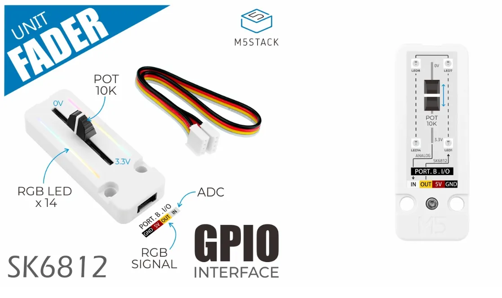

# M5Stack Unit Fader : Glissière
<!-- toc -->


## Introduction

L’unité **M5Stack Fader Unit** est équipé d’une glissière (_slider_ ou _fader_ en anglais) et de 14 pixels.

Page officielle du produit : [Unit Fader](https://docs.m5stack.com/en/unit/fader).

## Connexion

Voici les points de connexion du connecteur **Grove** du *M5Stack Fader Unit*  :
- 1 : GND - couleur noire
- 2 : VCC (5V) - couleur rouge
- 3 : SDA - couleur jaune : lecture analogique du potentiomètre
- 4 : SCL - couleur blanche : contrôle des pixels

La glissière n’utilise pas l’I2C mais interface directement avec les broches du connecteur Grove. 

Elle peut être reliée au :
- [Connecteur Grove du Arduino Terminals](/fabrication/arduino/terminals/grove/) en **désactivant** les résistances de rappel du connecteur Grove pour le mode direct.

> [!WARNING]
> Ne pas oublier de désactiver les résistances de rappel du connecteur Grove.


> [!NOTE]
> Pour un Arduino Nano:
> SDA correspond à la broche A4
> SCL correspond à la broche A5


<!-- ### Potentiomètre
- La lecture du potentiomètre s’effectue sur la broche identifiée par le texte *ANALOG*,  *ADC* ou *IN* sur fond blanc, ce qui correspond au fil blanc du câble Grove. 
- Si l’unité **M5Stack Fader Unit** est connectée directement au Atom Lite, c’est la broche 32 du Atom  qui permet d’effectuer la lecture numérique analogique du potentiomètre.

### Pixels
- Le contrôle des pixels s’effectue avec la broche identifiée par le texte **SK6812/RGB SIGNAL** ou **OUT** sur fond jaune, ce qui correspond au fil jaune du câble Grove. 
- Si l’unité **M5Stack Fader Unit** est connectée directement au Atom Lite, c’est la broche 26 (identifiée G26) qui permet de contrôler les pixels. -->

## Installation

Le contrôle des pixels nécessite la bibliothèque logicielle [FastLED](https://github.com/fastled/fastled).

Dans le fichier **platformio.ini** ajouter à la section `lib_deps` pour l’installer : 
```
lib_deps =
    FastLED
```

## Initialisation

### Dans l’espace global

Ajouter la bibliothèque logicielle FastLED:
```cpp
#include <FastLED.h>
```

Bien que cela ne soit pas absolument nécessaire, c’est une bonne idée d’utiliser des `#define` pour identifier les numéros de broches :
```cpp
#define FADER_BROCHE_ANALOG A4
#define FADER_BROCHE_PIXELS A5
```

Ajouter une variable de type CRGB Array pour le pixel du **M5Stack Fader Unit** :
```cpp
#define FADER_COMPTE_PIXELS 14
CRGB faderTableauPixels[FADER_COMPTE_PIXELS];
```
### Dans setup()

Initialiser FastLED pour les pixels du *M5Stack Fader Unit* :
```cpp
  FastLED.addLeds<WS2812, FADER_BROCHE_PIXELS, GRB>( faderTableauPixels , FADER_COMPTE_PIXELS);
```

Initialiser l’entrée du *M5Stack Fader Unit* :
```cpp
  pinMode( FADER_BROCHE_ANALOG , INPUT );
```

### Exemple d’initialisation

Voici un exemple de code de base qui initialise le *Fader Unit* :
```cpp
    #include <Arduino.h>
    // ...
    #include <FastLED.h>
    #define FADER_BROCHE_ANALOG A4
    #define FADER_BROCHE_PIXELS A5
    #define FADER_COMPTE_PIXELS 14
    CRGB faderTableauPixels[FADER_COMPTE_PIXELS];
    // ...
    void setup() {
        // ...
        FastLED.addLeds<WS2812, FADER_BROCHE_PIXELS, GRB>( faderTableauPixels , FADER_COMPTE_PIXELS);
        pinMode( FADER_BROCHE_ANALOG , INPUT );
        // ...
    }
    void loop() {
        // ...
    }
```
## Utilisation

### Lecture de la position de la glissière

Pour effectuer la lecture, nous utilisons la fonction `analogRead()` qui va retourner un nombre entre 0 et 1023 inclusivement proportionnel à la position du curseur de la glissière :
```cpp
int positionDuFader = analogRead( FADER_BROCHE_ANALOG );
```

**Par exemple**, pour envoyer avec [MicrOsc](/fabrication/arduino/microosc/) un flux tempéré par [Chrono](/fabrication/arduino/chrono/) de la position de la glissière :
```cpp    
#include <Arduino.h>
// ...
#include <FastLED.h>
#define FADER_BROCHE_ANALOG A4
#define FADER_BROCHE_PIXELS A5
#define FADER_COMPTE_PIXELS 14
CRGB faderTableauPixels[FADER_COMPTE_PIXELS];
// ...
#include <Chrono.h>
Chrono faderChrono;
// ...
#include <MicroOscSlip.h>
MicroOscSlip<128> monOsc(&Serial); 
// ...
void setup() {
    // ...
    FastLED.addLeds<WS2812, FADER_BROCHE_PIXELS, GRB>( faderTableauPixels , FADER_COMPTE_PIXELS);
    pinMode( FADER_BROCHE_ANALOG , INPUT );
      // ...
    Serial.begin(115200);
    // ...
}
void loop() {
    // ...
    if ( faderChrono.hasPassed(20) ) {
      faderChrono.restart();
      int positionDuFader = analogRead( FADER_BROCHE_ANALOG );
      monOsc.sendInt("/fader", positionDuFader);
    }
    // ...
}
```

### Pixels

La couleur de chaque pixel est déterminée avec des valeurs de rouge, vert et bleu entre 0 et 255 inclusivement. Ces valeurs peuvent être trouvées avec un outil tel que le [RGB Color Codes Chart 🎨](https://www.rapidtables.com/web/color/RGB_Color.html).

Pour changer les couleurs des pixels :

- Assigner une couleur à un index du tableau `faderTableauPixels`. Par exemple pour changer le troisième (3ᵉ pixel = index #2) pixel au mauve : `faderTableauPixels[2] = CRGB(255,0,255);`
- Répéter l'opération précédente pour d'autres pixels.
- Appeler `FastLED.show()` pour transférer les valeurs du tableau.

Par exemple, pour assigner la même couleur à tous les pixels : 
```cpp
  // ...
  for (int i =0; i < FADER_PIXELS_COUNT; i++) {
      faderPixels[i] = CRGB(255, 0, 0); // ROUGE
  }
  // ...
  FastLED.show()
```

#### Utilisation d'une palette

Il est possible de définir une palette à partir d'un gradient dans l'espace global :
```cpp
DEFINE_GRADIENT_PALETTE( gradient ) {
    0,    0,  10,  40,   // deep blue
   60,    0, 120,  90,   // teal-green
  130,   40, 220, 120,   // green
  190,  120, 200, 255,   // light cyan-blue
  255,   30,  20, 120    // back to deep blue-violet
};
CRGBPalette16 palette = gradient;
```

La palette peut être appliquée avec la fonction suivante ; le décalage `offset` est une valeur entre 0 et 255 qui fait glisser la palette sur la bande :
```cpp
void applyPalette(int offset) {
    for (int i = 0; i < FADER_COMPTE_PIXELS; i++) {
        uint8_t indexPalette = map(i, 0, FADER_COMPTE_PIXELS - 1, 0, 255) + offset; 
        faderTableauPixels[i] = ColorFromPalette(palette, indexPalette, 255, LINEARBLEND);
    }
}
```

Exemple de décalage de la palette selon la position de la glissière :

```cpp    
#include <Arduino.h>
// ...
#include <FastLED.h>
#define FADER_BROCHE_ANALOG A4
#define FADER_BROCHE_PIXELS A5
#define FADER_COMPTE_PIXELS 14
CRGB faderTableauPixels[FADER_COMPTE_PIXELS];
DEFINE_GRADIENT_PALETTE( gradient ) {
    0,    0,  10,  40,   // deep blue
   60,    0, 120,  90,   // teal-green
  130,   40, 220, 120,   // green
  190,  120, 200, 255,   // light cyan-blue
  255,   30,  20, 120    // back to deep blue-violet
};
CRGBPalette16 palette = gradient; // Swap for any of the built-ins: PartyColors_p, HeatColors_p, OceanColors_p, ...
// ...

void setup() {
    // ...
    FastLED.addLeds<WS2812, FADER_BROCHE_PIXELS, GRB>( faderTableauPixels , FADER_COMPTE_PIXELS);
    pinMode( FADER_BROCHE_ANALOG , INPUT );
    // ...
}

void applyPalette(int offset) {
    for (int i = 0; i < FADER_COMPTE_PIXELS; i++) {
        uint8_t indexPalette = map(i, 0, FADER_COMPTE_PIXELS - 1, 0, 255) + offset;
        faderTableauPixels[i] = ColorFromPalette(palette, indexPalette, 255, LINEARBLEND);
    }
}

void loop() {
    // ...
    int positionDuFader = analogRead( FADER_BROCHE_ANALOG );
    // Calculer le décalage de la palette selon la position de la glissière
    int decalageDePalette = map(positionDuFader, 0, 1023, 0, 255);
    applyPalette(decalageDePalette);
    // ...
    FastLED.show();
    // ...
}
```

