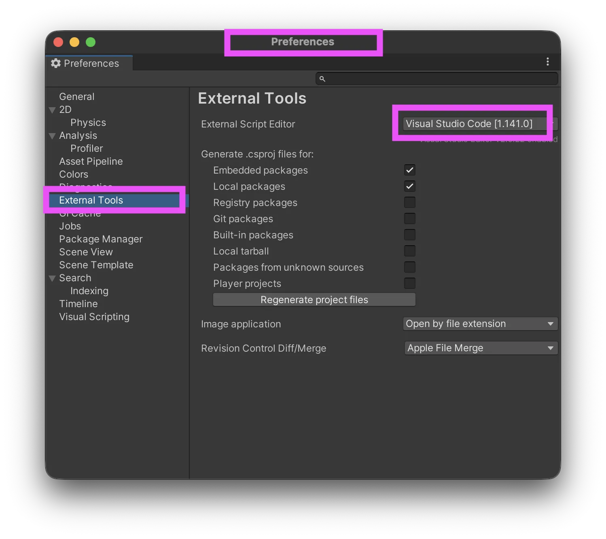
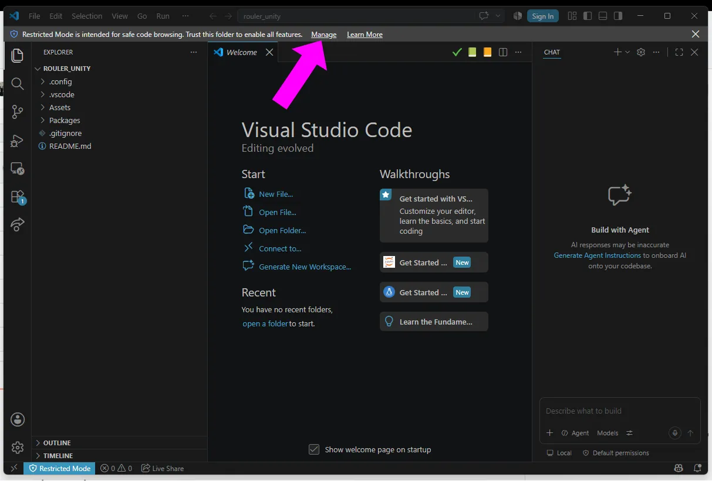
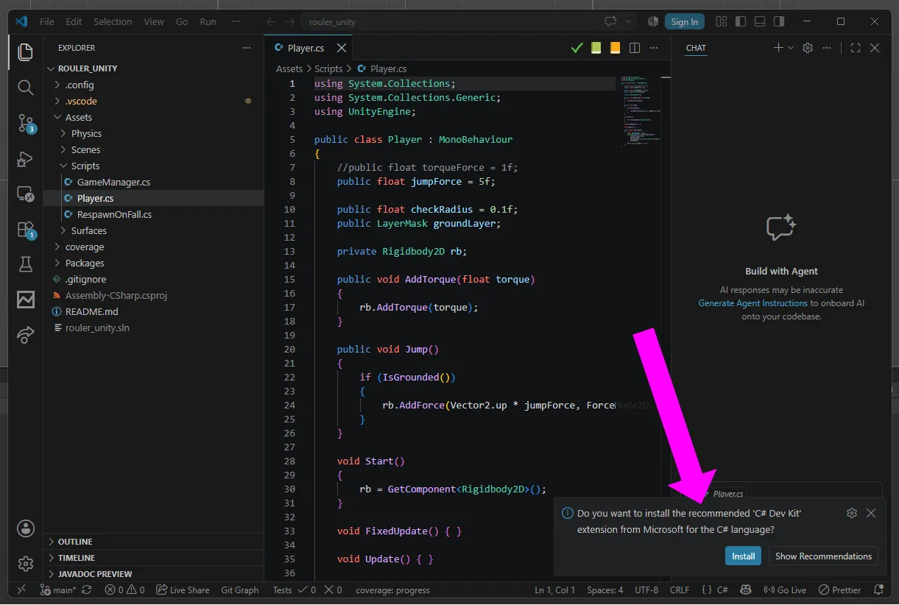
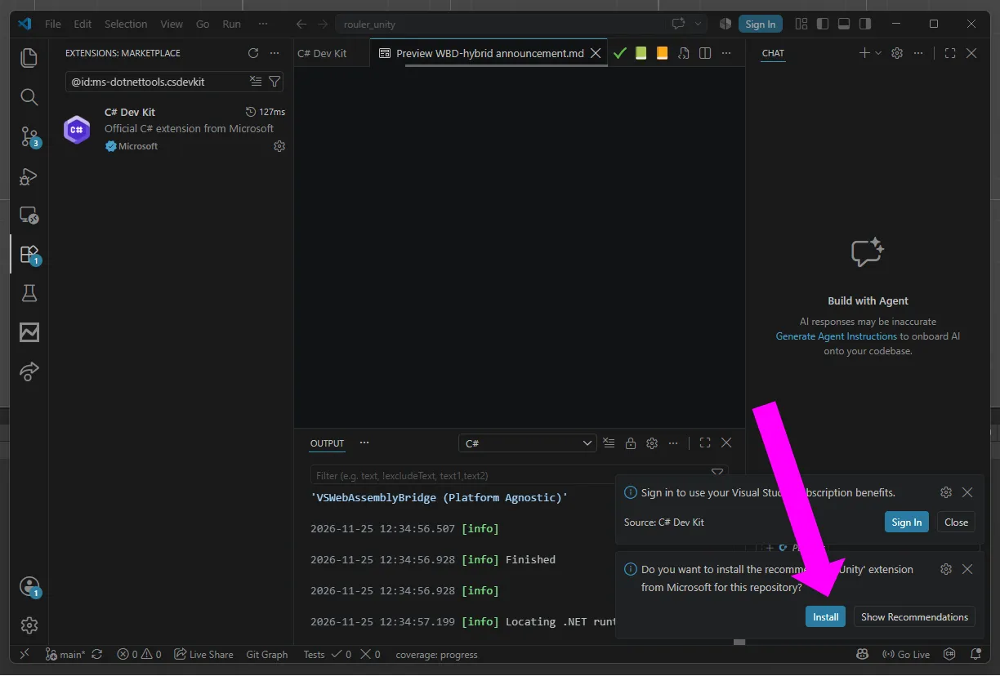
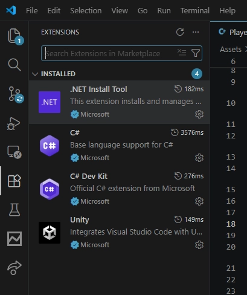
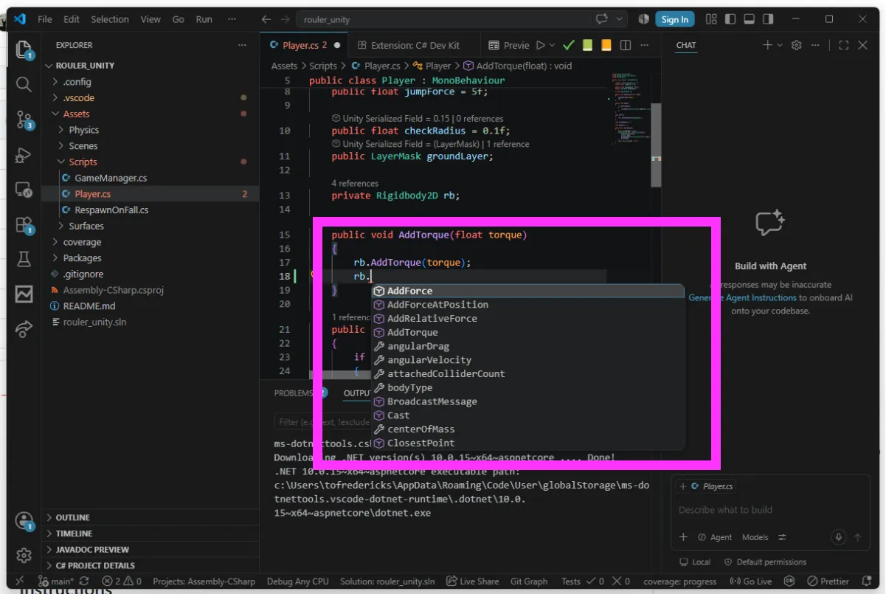

# Unity : Configuration pour Visual Studio Code

Pour utiliser Visual Studio Code avec Unity, il faut effectuer les étapes suivantes :
- Sélection de l’éditeur *Visual Studio Code* dans le menu **Préférences...** (ne pas confondre avec le menu *Project Settings...*).
- Double-cliquer sur un Script dans *Unity* pour que *Unity* lance *Visual Studio Code*.
- Dans *Visual Studio Code*, désactiver le mode restreint s’il est actif.
- Dans *Visual Studio Code*, installer l’extension c#.
- Dans *Visual Studio Code*, installer l’extension Unity.

> [!IMPORTANT]
> Ouvrir Visual Studio Code à partir d’Unity pour que les logiciels soient synchronisés !

Voici des captures d’écran des étapes :

