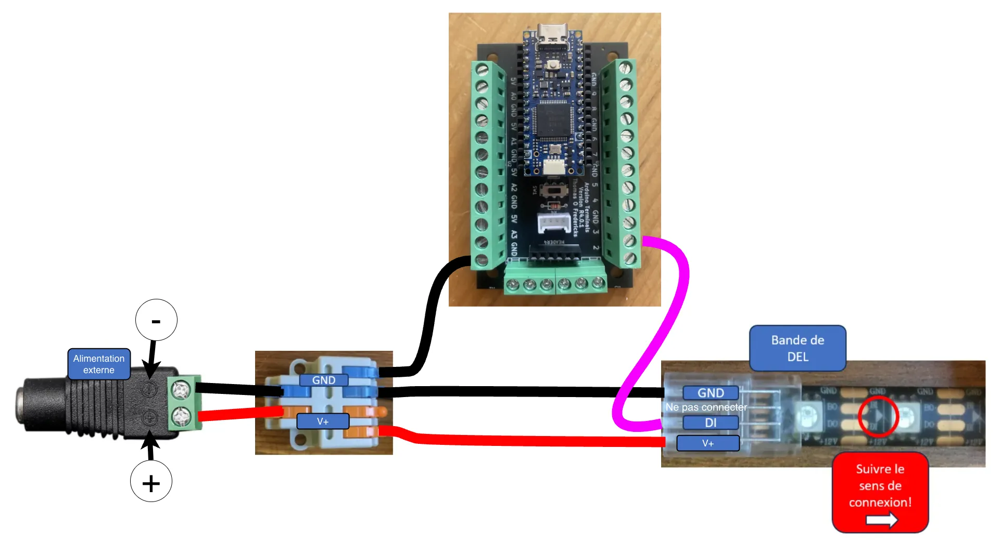
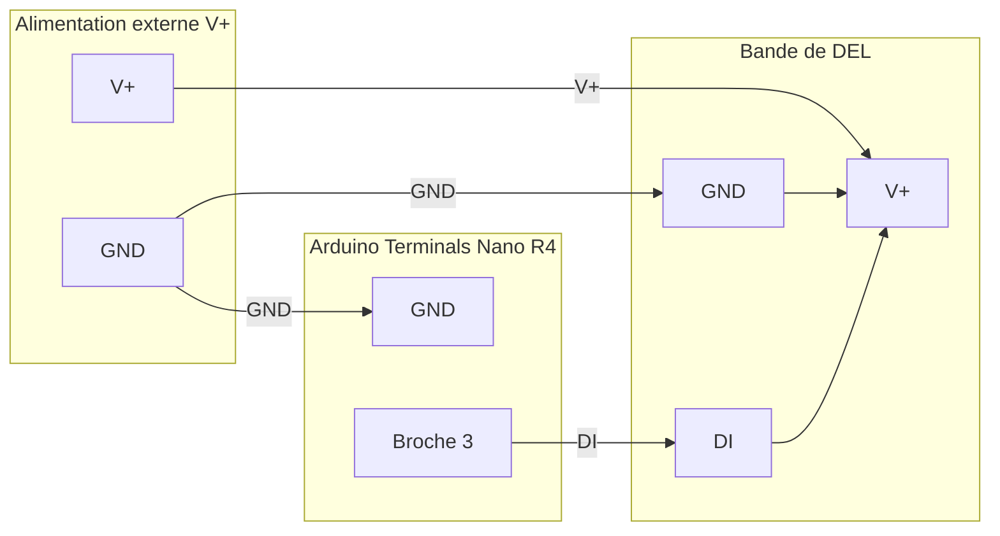

# Tutoriel : Bande de pixels avec un Arduino Terminals Nano R4
<!-- toc -->

## Introduction

Cette page décrit le câblage d’alimentation et le contrôle d’une [bande de pixels](/fabrication/pixels/) (*LED Strip* en anglais) depuis un [Arduino Terminals Nano R4](/fabrication/arduino/terminals/).

## Connexion



Le montage comprend :

- Une **alimentation DC**
- Un **connecteur de distribution** pour le V+ et le GND
- Un **Arduino Terminals Nano R4** servant de contrôleur
- Une **bande de pixels adressables**

L’alimentation doit être raccordée au connecteur de distribution. Respecter impérativement la polarité. Le V+ de l’alimentation DC doit correspondre à la tension d’alimentation de la bande de pixels (5 V, 12 V ou 24 volts selon le modèle de bande de pixels).

Le câblage doit être :

| Alimentation externe | Bande de pixels | Arduino | Note |
|--|--|--|--|
| `GND` | `GND` | `GND` | GND commun entre l’alimentation, la bande et le microcontrôleur |
| | `BI` | | Ne pas connecter |
| | `DI` | `Broche 3` | Signal de contrôle (choisir n’importe quelle broche numérotée de l’Arduino) |
| `V+` | `V+` | | 5 V, 12 V ou 24 volts selon le modèle |

Le même câblage en tant que schéma :



Le `GND` du microcontrôleur et le `GND` de la bande LED doivent être **communs** afin que le signal de données ait la même référence électrique.

> [!WARNING]
> Ne jamais appliquer directement V+ sur une entrée du microcontrôleur. 
## Installation

Le contrôle des pixels nécessite la bibliothèque logicielle [FastLED](https://github.com/fastled/fastled). Nous allons aussi utiliser [Chrono](/fabrication/arduino/chrono/).

Dans le fichier **platformio.ini**, ajouter les bibliothèques à la section `lib_deps` :
```
lib_deps =
    FastLED
    Chrono
```

**Pour contourner un bogue dans FastLED** avec un **Arduino Nano R4**, ajouter aussi les sections suivantes dans le fichier **platformio.ini**, après la section `lib_deps` :
```
lib_ignore =
    I2S
    WiFiS3
build_flags =
    -DARDUINO_UNOR4_MINIMA
```

## Initialisation

### Dans l’espace global

Ajouter les bibliothèques logicielles FastLED et Chrono :
```cpp
#include <FastLED.h>
#include <Chrono.h>
```

Bien que cela ne soit pas absolument nécessaire, c’est une bonne idée d’utiliser un `#define` pour identifier le numéro de broche (on utilise la broche 3 dans cet exemple) et le nombre de pixels :
```cpp
#define MES_PIXELS_BROCHE 3
#define MES_PIXELS_COMPTE 30
```

Ajouter un tableau de type CRGB pour les pixels :
```cpp
CRGB mesPixels[MES_PIXELS_COMPTE];
```

Ajouter un chronomètre :
```cpp
Chrono monChronoPixels;
```

### Dans setup()

Ajouter la bande de pixels à FastLED :
```cpp
  FastLED.addLeds<WS2812, MES_PIXELS_BROCHE, GRB>( mesPixels, MES_PIXELS_COMPTE );
```

## Utilisation

La couleur de chaque pixel est déterminée avec des valeurs de rouge, vert et bleu entre 0 et 255 inclusivement. Ces valeurs peuvent être trouvées avec un outil tel que le [RGB Color Codes Chart 🎨](https://www.rapidtables.com/web/color/RGB_Color.html).

Pour changer la couleur d’un pixel, il faut changer la couleur à un index du tableau `mesPixels` et ensuite faire un appel à `FastLED.show()`.

Par exemple, pour mettre la couleur mauve au troisième pixel, qui correspond à l’index 2 du tableau `mesPixels`, il faut écrire : `mesPixels[2] = CRGB(255,0,255);` suivi de `FastLED.show();`.

Par exemple, pour assigner la même couleur à tous les pixels :
```cpp
  // ...
  for (int i = 0; i < MES_PIXELS_COMPTE; i++) {
      mesPixels[i] = CRGB(255, 0, 0); // ROUGE
  }
  // ...
  FastLED.show();
```

## Exemple de clignotement

Dans cet exemple, nous utilisons le chronomètre `monChronoPixels` pour alterner la couleur de la bande de pixels, suivi d’un appel à `FastLED.show()`, à chaque 1000 millisecondes :

```cpp
#include <Arduino.h>
#include <FastLED.h>
#include <Chrono.h>

#define MES_PIXELS_BROCHE 3
#define MES_PIXELS_COMPTE 30
CRGB mesPixels[MES_PIXELS_COMPTE];
Chrono monChronoPixels;

bool monEtatClignotement = false;

void setup() {
    // ...
    FastLED.addLeds<WS2812, MES_PIXELS_BROCHE, GRB>( mesPixels, MES_PIXELS_COMPTE );
    // ...
}

void loop() {
    if ( monChronoPixels.hasPassed(1000) ) {
        monChronoPixels.restart();
        monEtatClignotement = !monEtatClignotement;

        if ( monEtatClignotement == false ) {
            for (int i = 0; i < MES_PIXELS_COMPTE; i++) {
                mesPixels[i] = CRGB(255, 0, 0); // ROUGE
            }
        } else {
            for (int i = 0; i < MES_PIXELS_COMPTE; i++) {
                mesPixels[i] = CRGB(0, 255, 0); // VERT
            }
        }
        FastLED.show();
    }
}
```

## Exemple de transition d’une couleur de palette vers une autre

```cpp


#include <Arduino.h>
#include <FastLED.h>
#include <Chrono.h>

#define MES_PIXELS_BROCHE 3
#define MES_PIXELS_COMPTE 30
    CRGB mesPixels[MES_PIXELS_COMPTE];
Chrono monChronoPixels;

DEFINE_GRADIENT_PALETTE( gradient ) {
    0,    0,  255,  0,   //  green
    85,    0,  0, 255,  // blue 
    170,   255,  0, 0,    // red
    255, 0, 255 ,0
};
CRGBPalette16 palette = gradient; // Swap for any of the built-ins: PartyColors_p, HeatColors_p, OceanColors_p, ...

int decalageDePalette = 0;

void setup()
{

    FastLED.addLeds<WS2812, MES_PIXELS_BROCHE, GRB>(mesPixels, MES_PIXELS_COMPTE);
}

void loop()
{
    if (monChronoPixels.hasPassed(20))
    {
        monChronoPixels.restart();

        decalageDePalette = decalageDePalette + 1;
        decalageDePalette = decalageDePalette % 256;
        for (int i = 0; i < MES_PIXELS_COMPTE; i++)
        {
            mesPixels[i] = ColorFromPalette(palette, decalageDePalette, 255, LINEARBLEND);
        }
        FastLED.show();
    }
}
```


## Exemple de palette et position XY

```cpp
#include <Arduino.h>
#include <FastLED.h>
#include <Chrono.h>

#define MES_PIXELS_BROCHE 3
#define MES_PIXELS_LARGEUR 15
#define MES_PIXELS_HAUTEUR 2
#define MES_PIXELS_COMPTE MES_PIXELS_HAUTEUR *MES_PIXELS_LARGEUR
CRGB mesPixels[MES_PIXELS_COMPTE];

Chrono monChronoPixels;
uint8_t compteur;

DEFINE_GRADIENT_PALETTE(gradient){
    0, 0, 255, 0,   //  green
    127, 0, 0, 255, // blue
    255, 255, 0, 0  // red
};
CRGBPalette16 palette = gradient; // Swap for any of the built-ins: PartyColors_p, HeatColors_p, OceanColors_p, ...

// Convert X,Y to array index
uint16_t XY(uint8_t x, uint8_t y, bool serpentine = false)
{
    // Handle out of bounds
    if (x >= MES_PIXELS_LARGEUR || y >= MES_PIXELS_HAUTEUR)
    {
        return 0;
    }
    if (serpentine && y & 0x01)
    {
        // If serptentine, ddd rows run backwards
        uint8_t reverseX = (MES_PIXELS_LARGEUR - 1) - x;
        return (y * MES_PIXELS_LARGEUR) + reverseX;
    }
    else
    {
        // Even rows run forwards
        return (y * MES_PIXELS_LARGEUR) + x;
    }
}

void setup()
{
    FastLED.addLeds<WS2812, MES_PIXELS_BROCHE, GRB>(mesPixels, MES_PIXELS_COMPTE);
}

void loop()
{
    if (monChronoPixels.hasPassed(20))
    {
        monChronoPixels.restart();
        uint8_t speed = 1;
        compteur = compteur + speed; // overflow 0-255

        for (int x = 0; x < MES_PIXELS_LARGEUR; x++)
        {
            for (int y = 0; y < MES_PIXELS_HAUTEUR; y++)
            {
                uint8_t zoom = 18;                          // 0-255
                uint8_t paletteIndex = compteur + x * zoom; // overflows 0-255
                CRGB color = ColorFromPalette(palette, paletteIndex, 255, LINEARBLEND);
                mesPixels[XY(x, y, true)] = color;
            }
        }
        FastLED.show();
    }
}
```

<!-- 
```cpp
#include <Arduino.h>
#include <FastLED.h>
#include <Chrono.h>

#define MES_PIXELS_BROCHE 3
#define MES_PIXELS_COMPTE 30
CRGB mesPixels[MES_PIXELS_COMPTE];
Chrono monChronoPixels;

DEFINE_GRADIENT_PALETTE( gradient ) {
    0,    0,  255,  0,   //  green
    127,    0,  0, 255,  // blue 
    255,   255,  0, 0    // red
};
CRGBPalette16 palette = gradient; // Swap for any of the built-ins: PartyColors_p, HeatColors_p, OceanColors_p, ...

int decalageDePalette = 0;

void setup() {
    
    FastLED.addLeds<WS2812, MES_PIXELS_BROCHE, GRB>( mesPixels, MES_PIXELS_COMPTE );
    
}
/*
 * @param pixels         Pointeur vers le tableau de pixels (type CRGB) à remplir.
 * @param pixelsCount    Nombre total de pixels dans le tableau.
 * @param repetitions    Nombre de fois que le dégradé est répété sur la bande.
 *                       Doit être au moins 1 et ne pas dépasser pixelsCount.
 * @param palette        Palette de 16 couleurs (CRGBPalette16) à étaler.
 * @param offset         Décalage (0–255) appliqué à l’index de palette,
 *                       utile pour animer le dégradé dans le temps.
 * @param zDisposition   Si vrai, les segments d’index impair (1, 3, 5…)
 *                       sont affichés en miroir : le dégradé y parcourt la
 *                       palette à l’envers. Conçu pour les bandes montées en
 *                       serpentin (aller-retour), où les segments physiquement
 *                       retournés doivent être lus dans l’autre sens.
 */
void spreadPalette(CRGB* pixels, size_t pixelsCount, size_t repetitions,
                   const CRGBPalette16& palette, uint8_t offset = 0,
                   bool zDisposition = false)
{
    if ( repetitions < 1 || pixelsCount < 1 || pixelsCount < repetitions ) return;
    size_t segmentPixelCount = pixelsCount / repetitions;

    for ( size_t i = 0; i < segmentPixelCount; i++ )         
    {
        uint8_t indexPalette8 = ( segmentPixelCount > 1 )
            ? (uint8_t)( ( i * 255 ) / ( segmentPixelCount - 1 ) + offset )
            : offset;

        for ( size_t r = 0; r < repetitions; r++ )           
        {
            bool inverser = zDisposition && ( r % 2 == 1 );
            size_t posDansSegment = inverser
                ? segmentPixelCount - 1 - i
                : i;

            pixels[ r * segmentPixelCount + posDansSegment ] =
                ColorFromPalette( palette, indexPalette8, 255, LINEARBLEND );
        }
    }
}

void loop() {
    if ( monChronoPixels.hasPassed(20) ) {
        monChronoPixels.restart();

        decalageDePalette = decalageDePalette + 1;
        decalageDePalette = decalageDePalette % 256;
        spreadPalette( mesPixels, MES_PIXELS_COMPTE, 1, palette, decalageDePalette); // tableau de pixels, compte de pixels, répétitions, palette, décalage 0-255
        FastLED.show();
    }
}

```
-->

## Exemple de feu

```cpp
#include <Arduino.h>
#include <FastLED.h>
#include <Chrono.h>

#define MES_PIXELS_BROCHE 3
#define MES_PIXELS_LARGEUR 7
#define MES_PIXELS_HAUTEUR 2
#define MES_PIXELS_COMPTE MES_PIXELS_HAUTEUR *MES_PIXELS_LARGEUR
CRGB mesPixels[MES_PIXELS_COMPTE];

Chrono monChronoPixels;


DEFINE_GRADIENT_PALETTE(gradient){
    0, 0, 0, 0,   //  black
    100 ,0 , 0 , 0, // black
    127, 255, 255, 0, // yellow
    160, 255, 0, 0, // red
    190, 255, 255, 0,
    255, 255, 255, 0  // purple
};
CRGBPalette16 palette = gradient; // Swap for any of the built-ins: PartyColors_p, HeatColors_p, OceanColors_p, ...

// Convert X,Y to array index
uint16_t XY(uint8_t x, uint8_t y, bool serpentine = false)
{
    // Handle out of bounds
    if (x >= MES_PIXELS_LARGEUR || y >= MES_PIXELS_HAUTEUR)
    {
        return 0;
    }
    if (serpentine && y & 0x01)
    {
        // If serptentine, ddd rows run backwards
        uint8_t reverseX = (MES_PIXELS_LARGEUR - 1) - x;
        return (y * MES_PIXELS_LARGEUR) + reverseX;
    }
    else
    {
        // Even rows run forwards
        return (y * MES_PIXELS_LARGEUR) + x;
    }
}

void setup()
{
    FastLED.addLeds<WS2812, MES_PIXELS_BROCHE, GRB>(mesPixels, MES_PIXELS_COMPTE);
}

void loop()
{
    if (monChronoPixels.hasPassed(20))
    {
        monChronoPixels.restart();

        unsigned long time = millis() / 10;
        
        for (int x = 0; x < MES_PIXELS_LARGEUR; x++)
        {
            for (int y = 0; y < MES_PIXELS_HAUTEUR; y++)
            {
                int zoomX = 540;
                int zoomY = 540;                
                uint8_t paletteIndex = inoise8(x * zoomX, y * zoomY, time); // 0-255

                CRGB color = ColorFromPalette(palette, paletteIndex, 255, LINEARBLEND);
                mesPixels[XY(x, y, true)] = color;
            }
        }
        FastLED.show();
    }
}
```