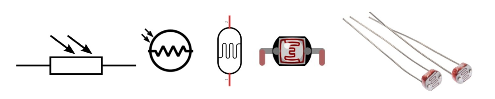
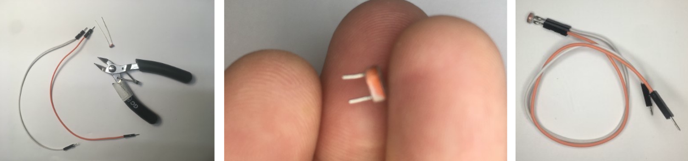
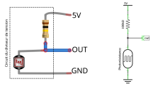

# Photorésistance

Une photorésistance est un composant électronique dont la résistance (exprimée en ohms, Ω) varie en fonction de l’intensité lumineuse.
Plus la luminosité est élevée, plus la résistance diminue.
Grâce à cette propriété, elle peut être utilisée comme capteur lumineux dans diverses applications :

- Mesure de la lumière ambiante (ex. : station météorologique).
- Détection de présence de lumière dans une pièce.
- Suivi de la lumière par un robot (suiveur de lumière).
- Détection de passage (ex. : interrupteur automatique).

Elles sont très peu coûteuses, mais ne conviennent pas pour des mesures précises de l’éclairement.
En revanche, elles sont idéales pour détecter des changements simples de luminosité (allumage/extinction, ombre/lumière, etc.).

## Soudure de fils à la photorésistance

## Connexion avec un diviseur de tension

La photorésistance doit être intégrée à un circuit en diviseur de tension pour être connectée à l’Arduino. Reliez la sortie (**OUT**) à une entrée analogique de l’Arduino.

Informations complémentaires sur les diviseurs de tension :  JIMBLOM. (s. d.). *Voltage Dividers*. SparkFun. [https://learn.sparkfun.com/tutorials/voltage-dividers](https://learn.sparkfun.com/tutorials/voltage-dividers)