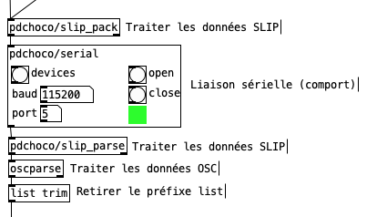
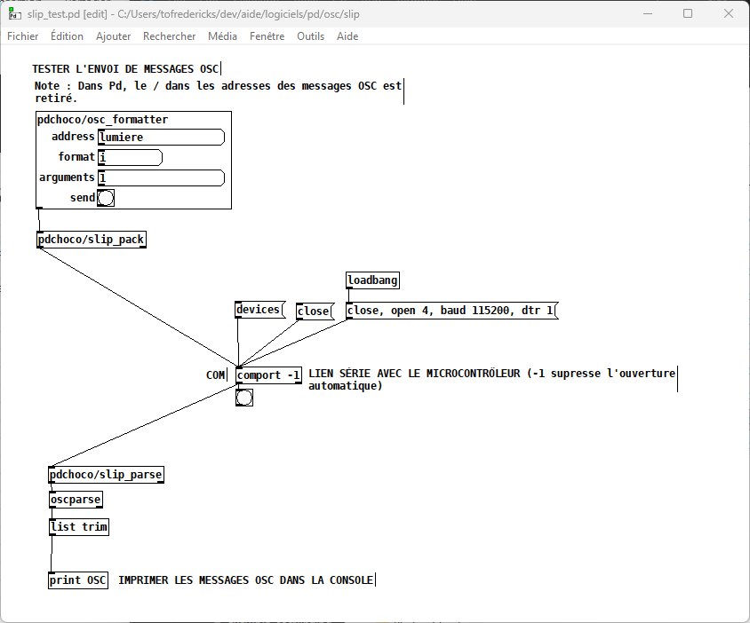
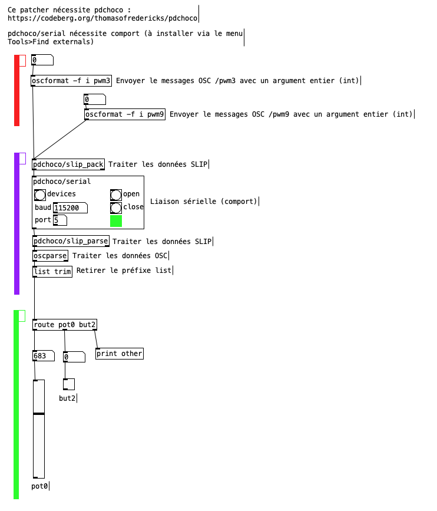

# Pd : OSC SLIP 

<!-- toc -->

## Installation des objets additionnels pour l’OSC SLIP dans Pure Data

Pour l’OSC SLIP dans Pd, il faut installer :
* [comport](../../serie/comport/)
* [pdchoco](../../pdchoco/)

<!--
## Bloc de base

-->

## Patcher pour tester l’OSC SLIP

Télécharger le patcher [ osc_slip_test.pd](./osc_slip_test.pd).

Liaison sérielle :

* `comport` : cet objet assure la communication bidirectionnelle via la liaison sérielle. Il faut indiquer le # de `port`, le `baud` (115200 dans l'exemple) et activer le `dtr`.

Envoi de SLIP :

* `pdchoco/slip_pack` : cet objet convertit les messages OSC brut en SLIP.

Réception d’OSC SLIP :

* `pdchoco/slip_parse` : cet objet convertit les données SLIP en OSC brut.
* `oscparse` : cet objet convertit la l'OSC brut en message Pd.
* `list trim` : cet objet supprime le sélecteur `list` qui précède le message Pd    afin que les données soient directement utilisables par les objets suivants.

<!--
## Exemple pour la réception de messages OSC SLIP 

Télécharger le patcher [slip_osc.pd](./slip_osc.pd).

-->