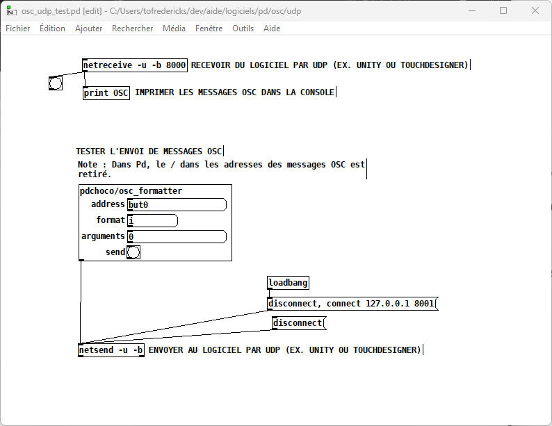
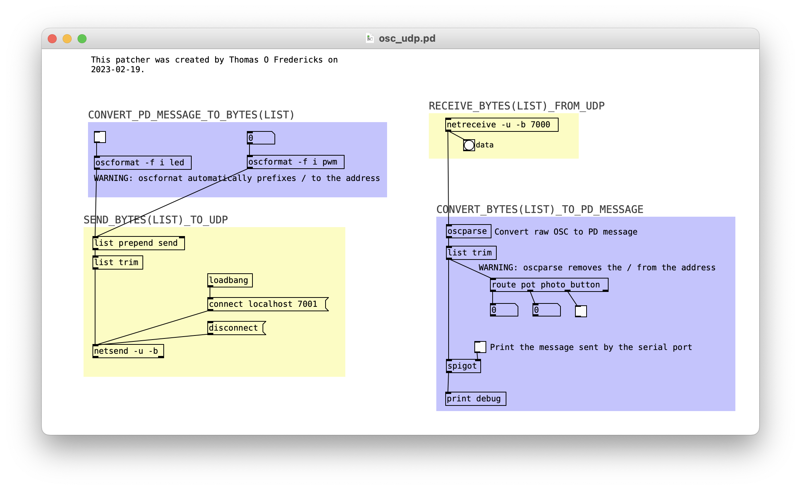

# Pd : OSC UDP

<!-- toc -->

Pd supporte nativement l’OSC UDP.

## Objets pour l’OSC UDP

| Objet | Rôle |
|---|---|
| `oscformat` | Encode en OSC (ajoute `/`) |
| `oscparse` | Décode l’OSC (retire `/`) |
| `netsend` | Envoie sur le réseau (UDP) |
| `netreceive` | Reçoit du réseau (UDP) |

### netsend : pour ENVOYER

`[netsend -u -b]` :
- `-u` : protocole **UDP** (rapide, sans confirmation)
- `-b` : mode **binaire** (obligatoire pour OSC)

Il faut se **connecter** à une adresse et un port (en se déconnectant avant) : `[disconnect, connect 127.0.0.1 7001(`

### netreceive : pour RECEVOIR

`[netreceive -u -b 7000]` :
- `-u -b` : pareil, UDP binaire
- `7000` : le **port** sur lequel il écoute

Dès qu’un paquet arrive, il sort une **liste d’octets** par sa sortie.

### oscformat : préparer l’OSC pour l’envoi

`[oscformat -f i led]` :
- `-f i` : format = entier
- `led` : adresse

Transforme des données Pd en **paquet OSC binaire**.

Attention : `oscformat` **ajoute automatiquement le `/`** devant l’adresse.

### oscparse : décoder l’OSC à la réception

`[oscparse]` :
Il prend une **liste d’octets OSC** et la transforme en **message Pd**.

Attention : `oscparse` **retire le `/`** de l’adresse.

## Patcher pour tester l’OSC UDP

Télécharger le patcher [osc_udp_test.pd](./osc_udp_test.pd).

## Exemple pour la réception et l’envoi de messages OSC UDP 

Pour télécharger le patcher, cliquer ici : [osc_udp.pd](osc_udp.pd).

Le patcher fait **deux choses opposées** :

- **Gauche** : fabriquer un message OSC et l’envoyer.
- **Droite** : recevoir un message OSC et le décoder.

Points importants : 

- Asymétrie des ports : envoie vers `7001`, écoute sur `7000`. Ce patcher parle donc à un autre programme qui fait l’inverse.
-  `oscformat` ajoute le `/`, `oscparse` le retire.
-  Toujours `-u -b` sur `netsend` et `netreceive` pour de l’OSC en UDP binaire.
-  `route` travaille sur l’adresse (le premier élément), pas sur les valeurs.
- `list trim` est nécessaire pour retirer le mot `list` qui précède les données.

### route : trier les messages reçus

`[route pot photo button]` :
- `pot` → sortie gauche
- `photo` → sortie 2
- `button` → sortie 3

Regarde le premier élément (l’adresse OSC) et envoie le message vers la bonne sortie.
