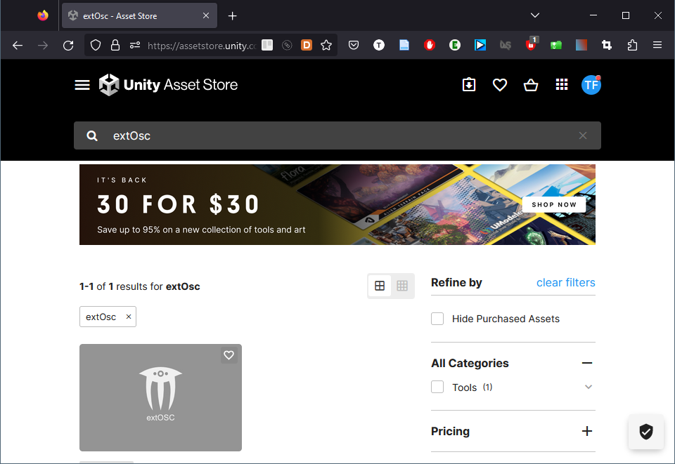
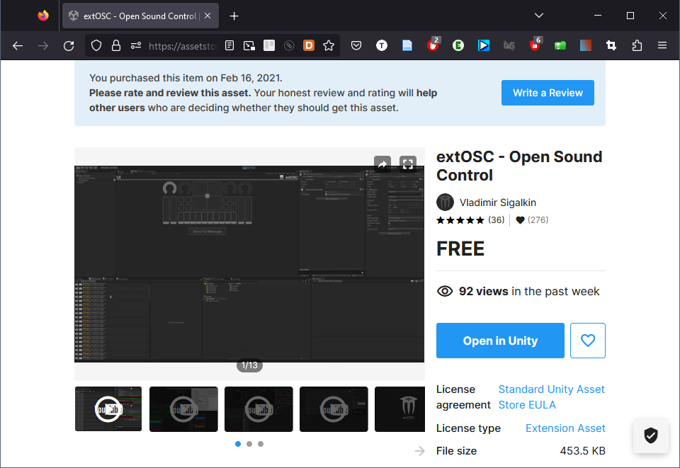
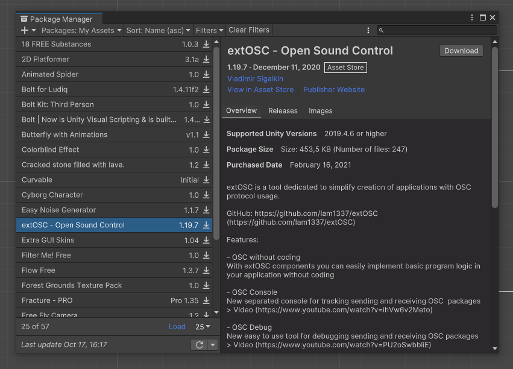
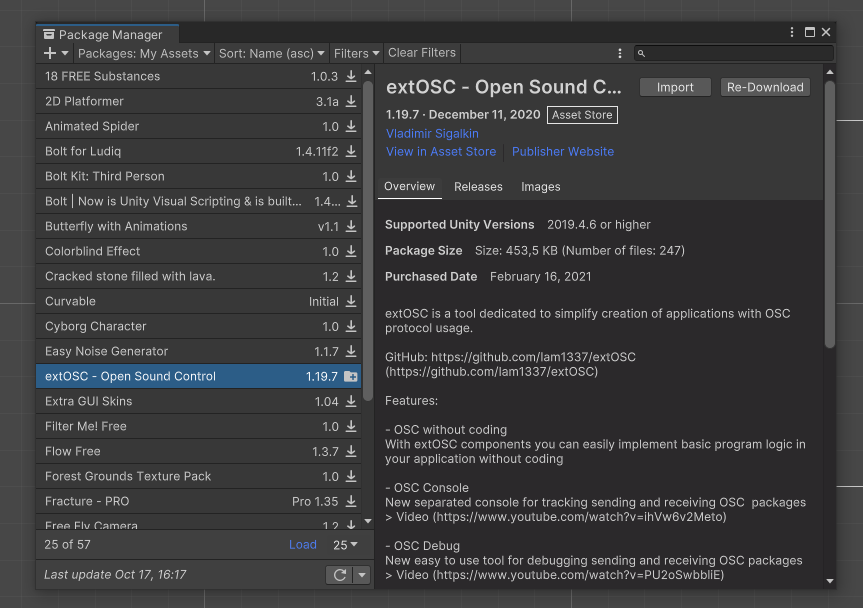
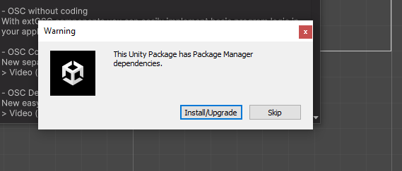
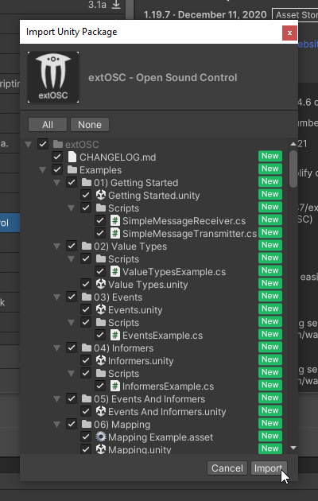
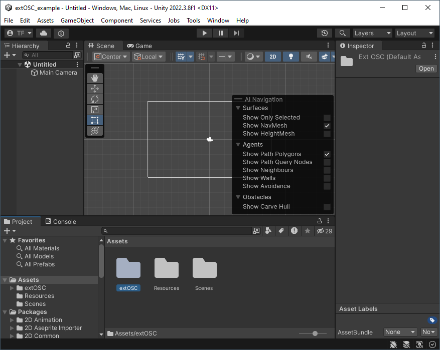
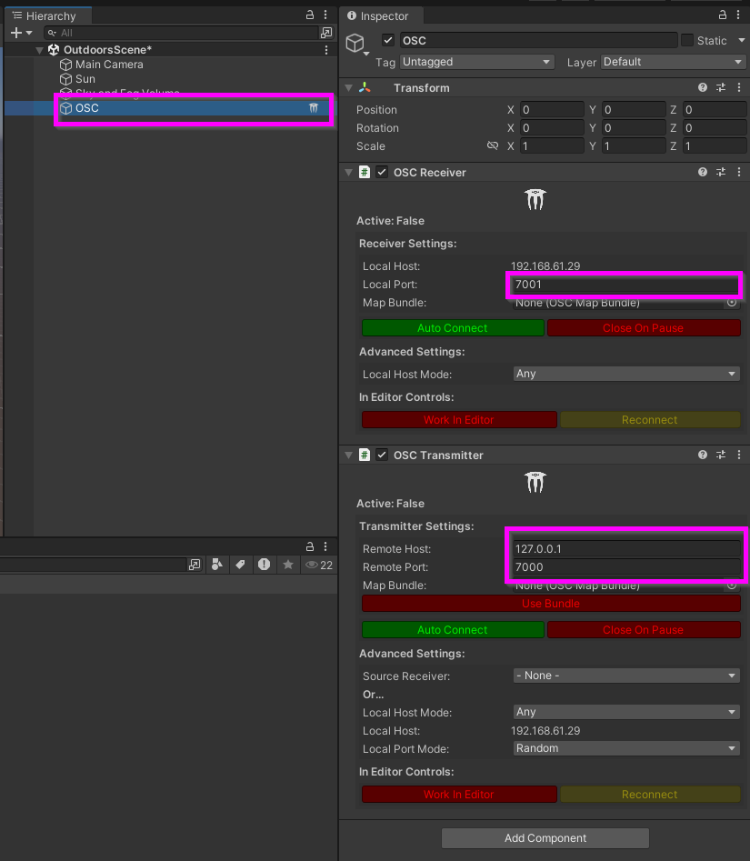
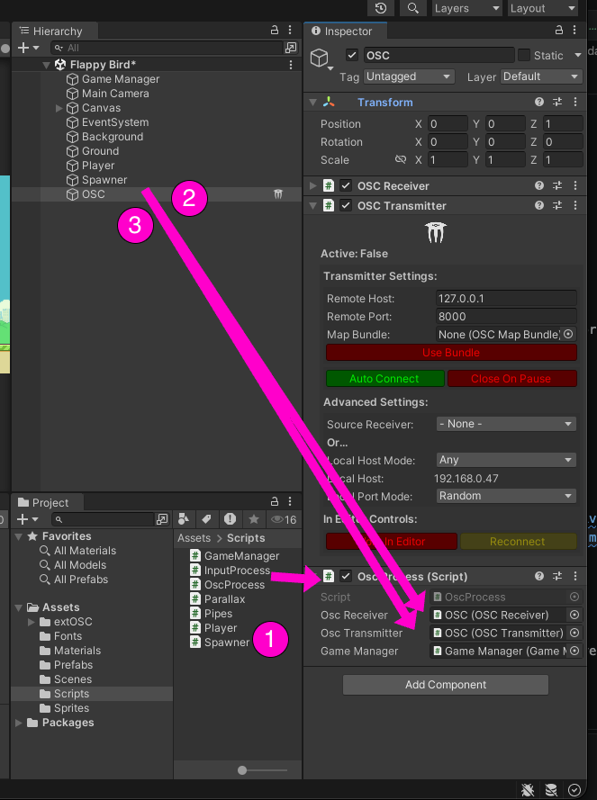

# extOsc : initialisation

<!-- toc -->

Ces instructions présentent l’intégration de l’OSC UDP dans Unity avec **extOSC**.

## Activer l’exécution en arrière-plan

Avant tout, il faut [activer l’exécution en arrière-plan](../../../execution_arriere-plan/) pour que Unity reçoive les messages OSC quand une autre application est en avant plan. 

## Installation d’extOSC dans Unity 

Recherchez « extOSC » dans l’[Asset Store](https://assetstore.unity.com/) (assurez-vous d’être connecté à votre compte Unity avant) :  


Cliquez sur le bouton pour ajouter « extOSC » à vos *assets*, puis cliquez de nouveau pour ouvrir l’*asset* dans Unity :  


Téléchargez le paquet « extOSC » à partir du gestionnaire de paquets :  


Cliquez sur le bouton pour importer le paquet « extOSC » :  


Installez toutes les dépendances :  


Importez tous les *assets* :  


Vous devriez maintenant voir *extOSC* dans vos *assets* :  



## GameObject OSC

> [!Note]
> Effectuez les étapes suivantes une seule fois par scène.

* Créez un nouveau *GameObject* vide nommé `OSC`.
* Ajoutez-y les scripts (inclus avec *extOSC*) `OSCTransmitter` et `OSCReceiver`.
* Configurez ces deux scripts avec les paramètres réseau appropriés.




## Script OscProcess

Créer un script nommé `OscProcess`. Effectuer les étapes suivantes dans ce script.

### Importer le namespace extOSC
Au début du script immédiatement après les autres `using` :
```csharp
using extOSC;
```

### Déclarer les propriétés du récepteur et de l’émetteur OSC
**Dans la classe** `OscProcess` (avant les méthodes pour plus de clarté), déclarer des propriétés `OSCReceiver` et `OSCTransmitter`:
```csharp
    public OSCReceiver oscReceiver;

    public OSCTransmitter oscTransmitter;
```

### De retour dans l’éditeur Unity lier les propriétés

- Glisser le script `OscProcess` sur le GameObject `OSC`.
- Dans l’Inspecteur, glisser-déposer le GameObject `OSC` sur la variable publique `oscReceiver` du script.
- Dans l’Inspecteur, glisser-déposer le GameObject `OSC` sur la variable publique `oscTransmitter` du script.




## Tutoriels

- [Tutoriel relais MicroOsc : Envoi d’OSC SLIP d’un Arduino Nano avec un bouton d’arcade vers OSC UDP](/tutoriels/arcade/relais/)
- [Tutoriel Flappy Bird : Unity, Pd, OSC et Arduino Nano avec bouton d’arcade](/tutoriels/arcade/flappy/)
- [Tutoriel Pong : Unity, Pd, OSC et Arduino Nano avec bouton d’arcade et potentiomètre](/tutoriels/arcade/pong)
