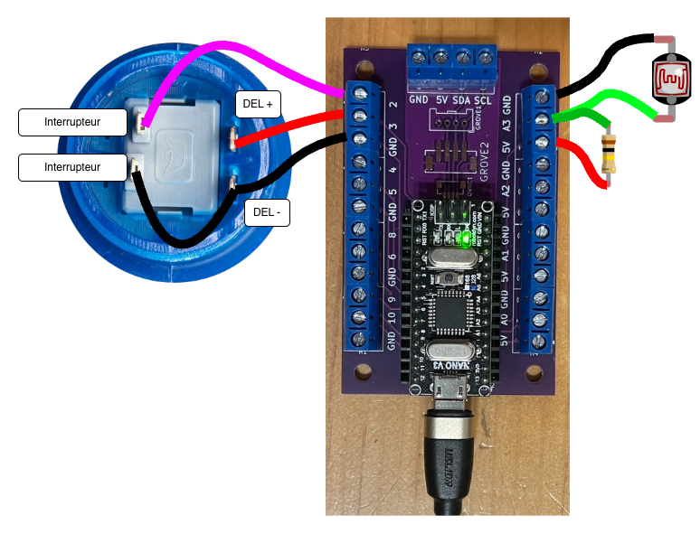

# Tutoriel astéroïde : OSC bidirectionnel entre Unity, Pd et Arduino Nano avec DEL et photorésistance

Dans ce tutoriel, nous voulons contrôler le jeu [thomasfredericks/asteroid_unity/](https://github.com/thomasfredericks/asteroid_unity/) avec une [photorésistance](/fabrication/electronique/composants/photoresistance/) et une DEL (nous allons utiliser la DEL du bouton d’Arcade).

Dans le jeu, il faut piloter le vaisseau de haut en bas pour éviter les astéroïdes.


## Comportement désiré de la photorésistance

- Quand on cache la lumière qui arrive sur la photorésistance :
    - Arduino envoie le message OSC SLIP `/photo` suivi d’un argument qui correspond à la mesure de la photorésistance.
    - Pd le relaye par UDP à Unity.
    - Unity contrôle la position verticale du vaisseau.


> [!IMPORTANT]
> Nous traitons le potentiomètre comme un **flux continu**.
> La valeur est lue continuellement et envoyée de façon régulière à Unity.
> Sa valeur se situe dans une plage de valeurs (typiquement entre `0` et `1023` inclusivement).

## Comportement désiré de la DEL

- Faire clignoter la DEL en même temps que le vaisseau à partir du message OSC `/lumiere`.

> [!IMPORTANT]
> Nous allons envoyer un message de Unity vers l’Arduino


## Circuit



Brancher un [bouton d’arcade](/fabrication/electronique/composants/bouton/arcade/) au circuit :
*   Un côté de l’interrupteur -> broche 2 de l’Arduino.
*   DEL+ du bouton -> broche 3 de l’Arduino.
*   Les deux autres câbles -> GND de l’Arduino.

Brancher une [photorésistance](/fabrication/electronique/composants/photoresistance/) au circuit :
*  Photorésistance entre broches A3 et GND.
*  Résistance 100k entre A3 et 5V.


## Code Arduino

- Créer un nouveau Git nommé `asteroid_arduino`.
- Le cloner et y démarrer un [nouveau projet PlatformIO](/fabrication/platformio/nouveau/) pour Arduino Nano.
- Ajouter les bibliothèques [Chrono](/fabrication/arduino/chrono/) et [Bounce](/fabrication/arduino/bounce2/) à `platormio.ini`.
- Ajouter la bibliothèque [MicroOsc](/fabrication/arduino/microosc/slip/).

### Initialiser MicroOsc

- Ajouter `#include <MicroOscSlip.h>` dans l’espace global.
- Dans l’espace global, instancier un `MicroOscSlip<128>` nommé `monOsc` et lié à `Serial` : 
```cpp
MicroOscSlip<128> monOsc(&Serial); 
```
- Dans `setup()`, initialiser `Serial` :
```cpp
Serial.begin(115200);
```

### Photorésistance

Pour générer un flux continu, nous allons utiliser la bibliothèque [Chrono](/fabrication/arduino/chrono/) pour lire la valeur de la photorésistance à intervalles réguliers.

- Ajouter `#include <Chrono.h>` dans l’espace global.
- Dans l’espace global, instancier un `Chrono` nommé `chronoPot` : 
```cpp
Chrono chronoPot;
```
- Dans `loop()`, envoyer le message OSC `/photo` suivi de la valeur du potentiomètre à chaque 20 millisecondes :
```cpp
if ( chronoPot.hasPassed(20)) { // SI LE CHRONO DÉPASSE 20 MILLISECONDES
    chronoPot.restart(); // REPARTIR LE CHRONO

    // LE 3 CI-BAS CORRESPOND À LA BROCHE ANALOGIQUE A3
    int valeur = analogRead(3); // LECTURE DE LA TENSION DE LA BROCHE A3 ENTRE 0 ET 1023

    monOsc.sendInt("/photo", valeur); // ENVOYER LA VALEUR
}
```

### Configuration de la DEL du bouton

- Dans `setup()`, initialiser la DEL du bouton :
```cpp
    pinMode(3,OUTPUT);
```


### Réception de l’OSC

- Dans l’espace global, ajouter une fonction qui sera appelée lorsqu’un message OSC  :
```cpp
// FONCTION APPELÉE LORSQU’UN MESSAGE OSC EST REÇU
void traiterMessageOsc(MicroOscMessage & message) {
    // SI L’ADRESSE DU MESSAGE EST "/lumiere" ET QUE LE MESSAGE CONTIENT UN ARGUMENT ENTIER ("i") :
     if (message.checkOscAddressAndTypeTags("/lumiere", "i")) {  

        int valeur = message.nextAsInt();  // RÉCUPÉRER L’ENTIER ("i")

        digitalWrite(3, valeur); // ASSIGNER LA VALEUR A LA DEL
   } 
}
```
- Ajouter au début de `loop()`, un appel à la fonction `onOscMessageReceived` qui va déclencher `traiterMessageOsc` si un message est reçu :
```cpp
monOsc.onOscMessageReceived(traiterMessageOsc); // ACQUISITION DES MESSAGES
```


> [!NOTE]
> Téléverser le code sur l’Arduino.
> Cela crée un flux d’environ ~50 messages par seconde (un message par 20 millisecondes) vers Pure Data.

### TESTER le code Arduino avec Pure Data

- Fermer tous les patchers Pd.
- Télécharger le **patcher pour tester l’OSC SLIP** de la page [Pd : OSC SLIP](/logiciels/pd/osc/slip/).
- Configurer `comport` 
- Les valeurs du message `/photo` devraient apparître dans la fenêtre de messages Pd.
- Noter, en déplaçant votre main au-dessus du capteur, le minimum et le maximum.
- Allumer et éteindre la DEL en envoyant les messages OSC `/lumiere 1` et `/lumiere 0` :
    - address : `lumiere`
    - format : `i`
    - arguments : `0` ou `1`
    
### Le patcher FINAL Pure Data pour effectuer le relais 

Dans l'étape précédente, nous avons **testé** et **validé** le code Arduino avec le **patcher pour tester l’OSC SLIP** . Nous fermons ce patcher et nous allons utiliser le patcher Pd qui effectue le relais entre Arduino et Unity comme solution finale.

Télécharger le patcher [relais_osc_slip_udp_bidirectionnel.pd](/logiciels/pd/osc/relais/relais_osc_slip_udp_bidirectionnel.pd), le copier dans le dossier de projet Arduino et configurer [comport](/logiciels/pd/serie/comport).

### Préalables Unity

- Fourcher (*forker*) le dépôt [thomasfredericks/asteroid_unity/](https://github.com/thomasfredericks/asteroid_unity/).
- Le cloner sur votre ordinateur.
- Il y aura ainsi deux dépôts Git pour ce tutoriel :
    - `asteroid_arduino` : qui contient le code Arduino et Pure Data.
    - `asteroid_unity` : qui contient le code Unity.
- Essayer de jouer au jeu **avant** de le modifier.
    - Utiliser la glissière pour contrôler la hauteur du vaisseau.

## Modifications au code Unity

### extOSC

- Suivre les instructions pour l’initialisation d’extOSC (ne pas commencer de `Bind` encore, ils seront détaillés plus loin) : [Unity : OSC UDP avec extOSC](/logiciels/unity/osc/extosc/initialisation/).

> [!NOTE]
> Il faut s’assurer que les # de ports OSC dans Pd et dans Unity se correspondent.
> Il y a des # de ports entrants et sortants !

### Pointer vers le script AsteroidDodger du GameObject GameManager

Pointer vers le script `AsteroidDodger` du GameObject `Game Manager` :
- Dans `OscProcess`, ajouter une variable de type `AsteroidDodger` nommée `asteroidDodger` dans la classe.
- De retour dans l’inspecteur de l’éditeur Unity, lier l'instance du script `AsteroidDodger` du GameObject `Game Manager` à la propriété `asteroidDodger` du script `OscProcess` du GameObject `OSC`.


### La photorésistance

La lecture de la photorésistance donne des valeurs possiblement entre 0 et 1023. Nous devons ajuster la plage de ces valeurs pour qu’elles correspondent aux coordonnées de position verticale de la palette.

- La méthode pour positionner le vaisseau est `SetShipY(targetY)` du script `AsteroidDodger` (qui vient d’être lié à la variable `asteroidDodger`).
- Dans `OscProcess`, effectuer un [Bind int vers argument float d’une méthode](/logiciels/unity/osc/extosc/bind/int_float/) entre le message `/photo` et la **destination** qui est la méthode `SetShipY(targetY)` du script `AsteroidDodger` (qui vient d’être lié à la variable `asteroidDodger`). 

### La DEL

- Dans `OscProcess`, nous allons envoyer à Pd qui va effectuer le relais à l’Arduino, le message `/lumiere` à chaque `Update()`. Ajouter le code suivant à `Update()` de `OscProcess` :
```csharp
if ( asteroidDodger.GetShipIsVisible() ) {
    var oscMessage = new OSCMessage("/lumiere"); 
    oscMessage.AddValue( OSCValue.Int(1) ); // Ajoute l’entier 1
    oscTransmitter.Send( oscMessage ) // Envoyer le message 
} else {
    var oscMessage = new OSCMessage("/lumiere"); 
    oscMessage.AddValue( OSCValue.Int(0) ); // Ajoute l’entier 0
    oscTransmitter.Send( oscMessage ) // Envoyer le message 
}
```

## Tester le tout

> [!WARNING]
> Ne pas oublier de faire les révisions (*commits*) des deux dépôts :
> - `asteroid_arduino` : qui contient le code Arduino et Pure Data.
> - `asteroid_unity` : qui contient le code Unity.

## Trouver la bonne page de valeurs de /photo

Votre vaisseau va être difficile à contrôler parce que la photorésistance n’envoie pas des valeurs qui couvrent la plage entière entre 0 et 1023. Il faut trouver quelle est la plage réelle :
- Arrêter le jeu Unity.
- Fermer le patcher Pd de relais.
- Télécharger le **patcher pour tester l’OSC SLIP** de la page [Pd : OSC SLIP](/logiciels/pd/osc/slip/).
- Configurer `comport` et observer les valeurs du message `/photo`.
- Noter, en déplaçant votre main au-dessus du capteur, le minimum et le maximum.
- Fermer le **patcher pour tester l’OSC SLIP**.
- Rouvrir le patcher Pd de relais.
- Configurer la bonne plage de valeurs dans l’inspecteur Unity du GameObject `OSC` :
    - in min : le minimum de la mesure analogique de la photorésistance
    - in max : le maximum de la mesure analogique de la photorésistance
    - out min : la position verticale minimale du vaisseau dans la scène 
    - out max : la position verticale maximale du vaisseau dans la scène 