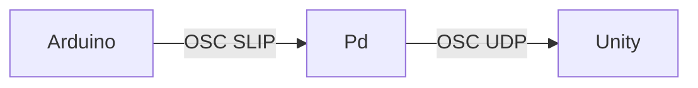
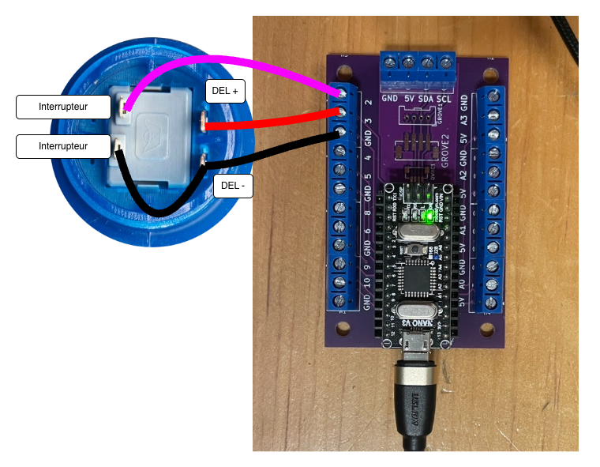
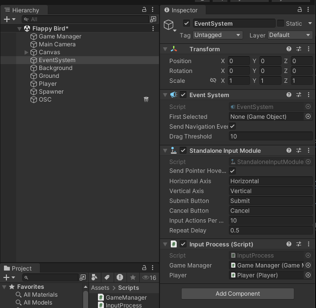
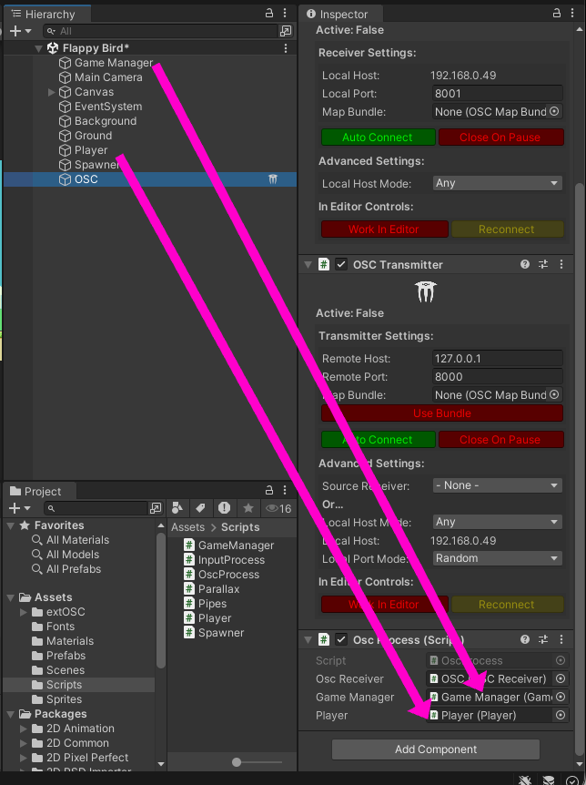
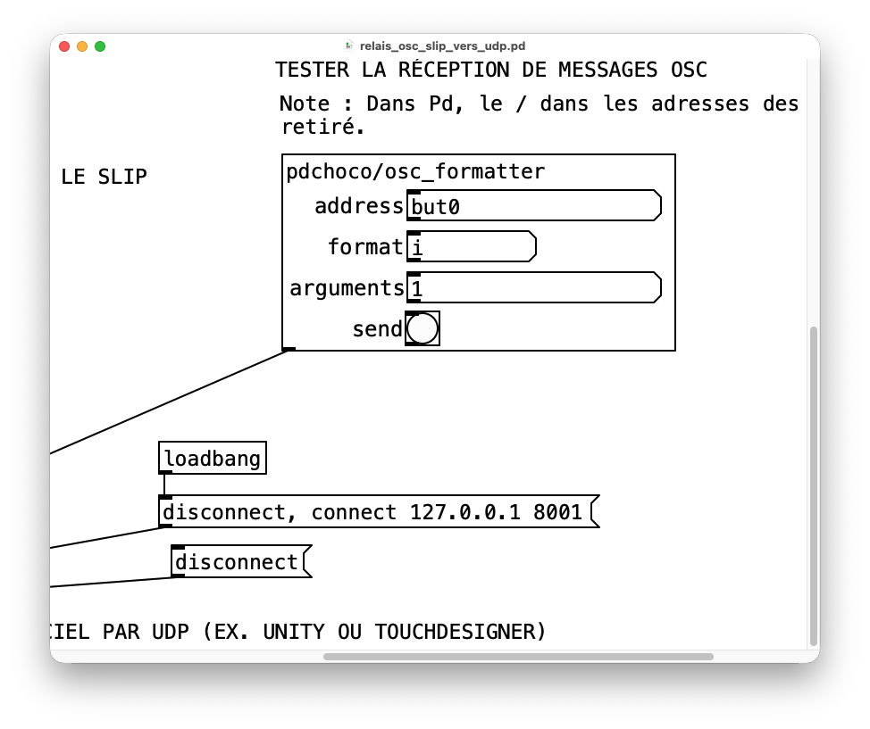
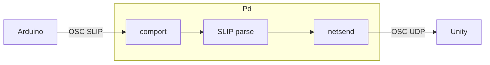

# Tutoriel Flappy Bird : Unity, Pd, OSC et Arduino Nano avec bouton d’arcade

Quand on appuie sur un bouton d’Arcade, cela envoie le message OSC SLIP `/but0 1` à Pd qui le relaye par UDP à Unity.



## Circuit



Brancher un [bouton d’arcade](/fabrication/electronique/composants/bouton/arcade/) au circuit :
*   Un côté de l’interrupteur -> broche 2 de l’Arduino.
*   DEL+ du bouton -> broche 3 de l’Arduino.
*   Les deux autres câbles -> GND de l’Arduino.


## Code Arduino

- Créer un nouveau Git nommé `falppy_arduino`.
- Le cloner et y démarrer un [nouveau projet PlatformIO](/fabrication/platformio/nouveau/) pour Arduino Nano.
- Ajouter les bibliothèques [Chrono](/fabrication/arduino/chrono/) et [Bounce](/fabrication/arduino/bounce2/) à `platormio.ini`.
- Ajouter la bibliothèque [MicroOsc](/fabrication/arduino/microosc/slip/).

### Initialiser MicroOsc

- Ajouter `#include <MicroOscSlip.h>` dans l’espace global.
- Dans l’espace global, instancier un `MicroOscSlip<128>` nommé `monOsc` et lié à `Serial` : 
```cpp
MicroOscSlip<128> monOsc(&Serial); 
```
- Dans `setup()`, initialiser `Serial` :
```cpp
Serial.begin(115200);
```

### Interrupteur du bouton d’arcade dans Arduino

- Ajouter `#include <Bounce2.h>` dans l’espace global.
- Dans l’espace global, instancier un `Bounce2::Button` nommé `bouton` : 
```cpp
Bounce2::Button bouton;
```
- Dans `setup()`, initialiser le bouton :
```cpp
    bouton.attach(2, INPUT_PULLUP);
    bouton.setPressedState(LOW);
```
- Dans `loop()`, mettre à jour le bouton :
```cpp
    bouton.update();
```
- Dans `loop()`, le moment que le bouton est appuyé, envoyer le message OSC `/valider 1`:
```cpp
    if (bouton.pressed()) { // Bouton vient d’être appuyé
        monOsc.sendInt("/but0", 1);
    }
```

## Investiguer le code Unity

Identifier le code Unity pour trouver le bloc de code ou la méthode qui :
- Démarre le jeu.
- Bat les ailes du personnage.

Dans le script `InputProcess` on retrouve les lignes suivantes :
```csharp
    public GameManager gameManager;
    public Player player;
```

Ainsi que celles-ci :
```csharp
    void Update()
    {
        if ( (Input.GetKeyDown(KeyCode.Space) || Input.GetMouseButtonDown(0)))
        {
            gameManager.StartGame(); // Ignored if game is already playing, handled in GameManager
            player.Jump();}
    }
```



Nous arrivons à la conclusion que nous devons déclencher les méthodes suivantes :
- `StarGame()` du script `GameManager`.
- `Jump()` du script `Player`.

## Modifier le code Unity

### Lier les scripts de destination

Dans `OscProcess` nous devons ajouter les deux propriétés suivantes :
```csharp
    public GameManager gameManager;
    public Player player;
``` 

Voici un rappel d'où placer ces proprités :
```csharp
// ...
public class OscProcess : MonoBehaviour
{
    // ...
    public GameManager gameManager;
    public Player player;
    
    void Start() {
        // ...
    }
    void Update() {
        // ...
    }
}
```




### Bouton dans Unity

- Le code ci-bas montre comment effectuer dans `OscProcess` :
    - un [Bind int traité dans un if](/logiciels/unity/osc/extosc/bind/int_if/) entre le message `/but0` et les **destinations** :
        - la méthode `StartGame()` du script `GameManager` (lié à la variable `gameManager`).
        -  la méthode `Jump()` du script `Player` (lié à la variable `player`). 

Le contenu du `Start()` dans `OscProcess`:
```csharp
   void Start()
    {
        // ...
        oscReceiver.Bind("/but0", TraiterMessageBut0);
        // ...
    }
```

Le contenu de `TraiterMessageBut0()` dans `OscProcess` :
```csharp
void TraiterMessageBut0(OSCMessage message)
    {
        // Récupérer la valeur du premier argument en taant qu’entier :
        int valeur = message.Values[0].IntValue;

        // Deboguer
        // Debug.Log("Reçu : " + message.Address + " " + valeur);

        // Traiter la valeur
        if ( valeur == 0 ) {
            gameManager.StartGame();
            player.Jump();
        } else {
            // Si nécéssaire, appeler une fonction ici
        }
    }
```


> [!NOTE]
> Appuyer sur Play pour partir le projet Unity!

## Le patcher Pd

Le patcher Pd `relais_osc_slip_vers_udp.pd` permet :
- D’envoyer des messages OSC UDP à Unity.
- De relayer les messages OSC SLIP reçus par `comport` en OSC UDP à Unity.


Télécharger le patcher ici : [relais_osc_slip_vers_udp.pd](./relais_osc_slip_vers_udp.pd)

> [!WARNING]
> Dans le patcher `relais_osc_slip_vers_udp.pd`, il faut s’assurer que le port UDP est le même que celui du `OSC Receiver` du GameObject `OSC` dans Unity. Il est de 8001 dans l’image plus bas, mais est-ce que c’est le bon ?

Il est possible de tester la réception de l’OSC dans Unity à l’aide de `pdchoco/osc_formatter`. Y entrer les informations suivantes et appuyer sur `send` :
- **address** : `but0` (ce qui correspond en OSC à /but0)
- **format** : `i` (un entier)
- **arguments** : `1`




> [!NOTE]
> Terminer de configurer `comport` et appuyer sur le bouton d’arcade ; Flappy devrait battre des ailes !

Les messages OSC SLIP sont envoyés à Pure Data qui les relaye à Unity en OSC UDP.

