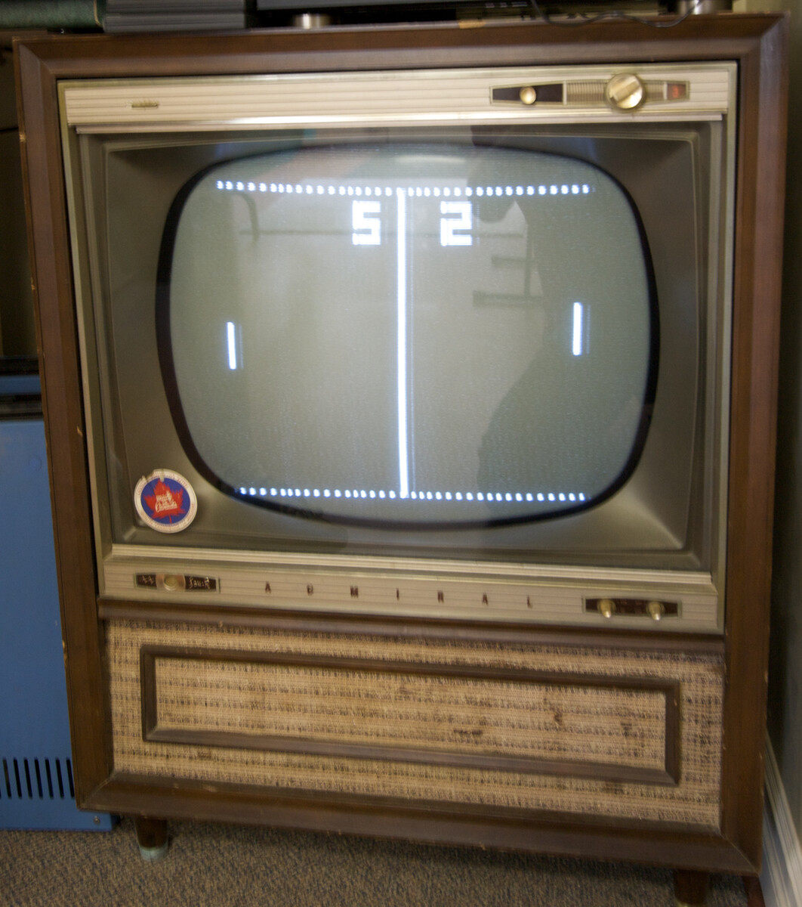
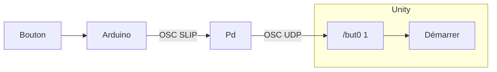
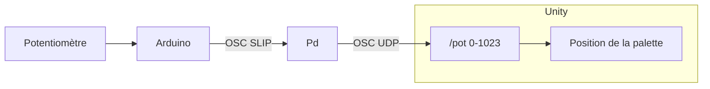

# Tutoriel Pong : Unity, Pd, OSC et Arduino Nano avec bouton d’arcade et potentiomètre

Dans ce tutoriel, nous voulons contrôler le jeu [thomasfredericks/unity-pong](https://github.com/thomasfredericks/unity-pong) avec un bouton pour le lancer de la balle et un [potentiomètre](/fabrication/electronique/composants/potentiometre/) pour la position de la palette.   



### Comportement désiré du bouton

- Quand on appuie sur un bouton d’Arcade :
    - Arduino envoie le message OSC SLIP `/but0 1` à Pd.
    - Pd le relaye par UDP à Unity.
    - Unity lance la balle de Pong.



> [!IMPORTANT]
> Nous traitons le bouton comme un **événement discret**.
> Le message n’est envoyé que lors de l’appui ou du relâchement.
> Si le bouton est maintenu, rien de nouveau n’est envoyé.
> Sa valeur est booléenne : `0` ou `1`.

### Comportement désiré du potentiomètre

- Quand on tourne le potentiomètre :
    - Arduino envoie le message OSC SLIP `/pot` suivi d’un argument entre `0` et `1023` à Pd.
    - Pd le relaye par UDP à Unity.
    - Unity contrôle la palette du joueur.





> [!IMPORTANT]
> Nous traitons le potentiomètre comme un **flux continu**.
> La valeur est lue continuellement et envoyée de façon régulière à Unity.
> Sa valeur se situe dans une plage de valeurs (typiquement entre `0` et `1023` inclusivement).

### Récapitulatif

| Captation | Type | Fréquence | Plage |
| --- | --- | --- | --- |
| Bouton avec `pressed()` ou `released()` | Évènement discret | Une fois quand l’état du bouton change | `0` ou `1` |
| Potentiomètre avec `analogRead()` | Flux continu | Envoyé de façon continue à chaque 20 millisecondes | Entre `0` et `1023` inclusivement |


## Circuit


Brancher un [bouton d’arcade](/fabrication/electronique/composants/bouton/arcade/) au circuit :
*   Un côté de l’interrupteur -> broche 2 de l’Arduino.
*   DEL+ du bouton -> broche 3 de l’Arduino.
*   Les deux autres câbles -> GND de l’Arduino.

Brancher un [potentiomètre](/fabrication/electronique/composants/potentiometre/) au circuit :
*   Broche centrale du potentiomètre -> broche A2 sur l’Arduino.
*   Les deux autres broches -> 5V et GND.


## Code Arduino

- Créer un nouveau Git nommé `pong_bouton_pot_arduino`.
- Le cloner et y démarrer un [nouveau projet PlatformIO](/fabrication/platformio/nouveau/) pour Arduino Nano.
- Ajouter les bibliothèques [Chrono](/fabrication/arduino/chrono/) et [Bounce](/fabrication/arduino/bounce2/) à `platormio.ini`.
- Ajouter la bibliothèque [MicroOsc](/fabrication/arduino/microosc/slip/).

### Initialiser MicroOsc

- Ajouter `#include <MicroOscSlip.h>` dans l’espace global.
- Dans l’espace global, instancier un `MicroOscSlip<128>` nommé `monOsc` et lié à `Serial` : 
```cpp
MicroOscSlip<128> monOsc(&Serial); 
```
- Dans `setup()`, initialiser `Serial` :
```cpp
Serial.begin(115200);
```

### Interrupteur du bouton d’arcade dans Arduino

- Ajouter `#include <Bounce2.h>` dans l’espace global.
- Dans l’espace global, instancier un `Bounce2::Button` nommé `bouton` : 
```cpp
Bounce2::Button bouton;
```
- Dans `setup()`, initialiser le bouton :
```cpp
    bouton.attach(2, INPUT_PULLUP);
    bouton.setPressedState(LOW);
```
- Dans `loop()`, mettre à jour le bouton :
```cpp
    bouton.update();
```
- Dans `loop()`, le moment que le bouton est appuyé, envoyer le message OSC `/valider 1`:
```cpp
    if (bouton.pressed()) { // Bouton vient d’être appuyé
        monOsc.sendInt("/but0", 1);
    }
```

### Potentiomètre dans Arduino

Pour générer un flux continu, nous allons utiliser la bibliothèque [Chrono](/fabrication/arduino/chrono/) pour lire la valeur du potentiomètre à intervalles réguliers.

- Ajouter `#include <Chrono.h>` dans l’espace global.
- Dans l’espace global, instancier un `Chrono` nommé `chronoPot` : 
```cpp
Chrono chronoPot;
```
- Dans `loop()`, envoyer le message OSC `/tourner` suivi de la valeur du potentiomètre à chaque 20 millisecondes :
```cpp
if ( chronoPot.hasPassed(20)) { // SI LE CHRONO DÉPASSE 20 MILLISECONDES
    chronoPot.restart(); // REPARTIR LE CHRONO

    // LE 2 CI_BAS CORRESPOND À LA BROCHE ANALOGIQUE A2
    int valeur = analogRead(2); // LECTURE DE LA TENSION DE LA BROCHE A2 ENTRE 0 ET 1023

    monOsc.sendInt("/pot", valeur); // ENVOYER LA VALEUR
}
```


## Pure Data

Télécharger le patcher [relais_osc_slip_vers_udp.pd](./relais_osc_slip_vers_udp.pd), le copier dans le dossier de projet Arduino `pong_bouton_pot_arduino` et configurer [comport](/logiciels/pd/serie/comport).

## Préparation d'Unity

- Fourcher (*forker*) le dépôt [thomasfredericks/unity-pong](https://github.com/thomasfredericks/unity-pong).
- Renommer le projet `pong_bouton_pot_unity`.
- Le cloner sur votre ordinateur.
- Il y aura ainsi deux dépôts Git pour ce tutoriel :
    - `pong_bouton_pot_arduino` : qui contient le code Arduino et Pure Data.
    - `pong_bouton_pot_unity` : qui contient le code Unity.
- Essayer de jouer au jeu **avant** de le modifier.
    - Cliquer et maintenir le bouton de la souris pour bouger la palette.
    - La touche espace lance la balle. 

> [!NOTE]
> Il faut s’assurer que les # de ports OSC dans Pd et dans Unity sont les mêmes.

## Modifications au code Unity

### extOSC

- Suivre les instructions pour l’initialisation d’extOSC (ne pas commencer de `Bind` encore, ils seront détaillés plus loin) : [Unity : OSC UDP avec extOSC](/logiciels/unity/osc/extosc/initialisation/).


### Pointer vers les scripts GameManager et PlayerPaddle

Pointer vers le script `GameManager` du GameObject `Game Manager` :
- Dans `OscProcess`, ajouter dans la classe une variable de type `GameManager` nommée `gameManager`.
- Dans `OscProcess`, ajouter dans la classe une variable de type `PlayerPaddle` nommée `playerPaddle`.
- De retour dans l’inspecteur de l’éditeur Unity, lier le GameObject `Game Manager` à la propriété `gameManager` du script `OscProcess` du GameObject `OSC`.
- Dans l’inspecteur de l’éditeur Unity, lier le GameObject `Player` à la propriété `playerPaddle` du script `OscProcess` du GameObject `OSC`.


### Le bouton dans Unity

- Dans le code Unity, la fonction utilisée pour lancer la balle est `ThrowBall()` du script `GameManager` (lié à la variable `gameManager`).
- Le code ci-bas montre comment effectuer dans `OscProcess`, un [Bind int traité dans un if](/logiciels/unity/osc/extosc/bind/int_if/) entre le message `/but0` et la **destination** qui est la méthode `ThrowBall()` du script `GameManager` (lié à la variable `gameManager`). 

Le contenu du `Start()` dans `OscProcess` :
```csharp
   void Start()
    {
        // ...
        oscReceiver.Bind("/but0", TraiterMessageBut0);
        // ...
    }
```

Le contenu de `TraiterMessageBut0()` dans `OscProcess` :
```csharp
void TraiterMessageBut0(OSCMessage message)
    {
        // Récupérer la valeur du premier argument en taant qu’entier :
        int valeur = message.Values[0].IntValue;

        // Deboguer
        // Debug.Log("Reçu : " + message.Address + " " + valeur);

        // Traiter la valeur
        if ( valeur == 0 ) {
            gameManager.ThrowBall();
        } else {
            // Si nécéssaire, appeler une fonction ici
        }
    }
```


### Le potentiomètre dans Unity

- Dans le code Unity, la fonction utilisée pour déplacer la palette est `SetPosition(float y)` du script `PlayerPaddle` (lié à la variable `playerPaddle`).
- Le code ci-bas montre comment effectuer dans `OscProcess` un [Bind int vers argument float d’une méthode](/logiciels/unity/osc/extosc/bind/int_float/) entre le message `/pot` et la **destination** qui est la méthode `SetPosition(float y)` du script `PlayerPaddle`  (lié à la variable `playerPaddle`). 

Dans les propriétés de la classe dans `OscProcess` :
```csharp
    public int potInMin = 0;
    public int potInMax = 1023;
    public float potOutMin = 0.0f;
    public float potOutMax = 1.0f;
```

Le contenu du `Start()` dans `OscProcess`:
```csharp
   void Start()
    {
        // ...
        oscReceiver.Bind("/pot", TraiterMessagePot);
        // ...
    }
```

Le contenu de `TraiterMessagePot()` dans `OscProcess` :
```csharp
void TraiterMessagePot(OSCMessage message)
    {
        // Récupérer la valeur du premier argument en taant qu’entier :
        int valeur = message.Values[0].IntValue;

        // Deboguer
        // Debug.Log("Reçu : " + message.Address + " " + valeur);

        // Ajustement de la valeur
        float ajustee = (
            ((float)valeur - potInMin) / (potInMax - potInMin) * (potOutMax - potaOutMin) + potOutMin
        );
        
        // DESTINATION
        playerPaddle.SetPosition(ajustee);
    }
```

La lecture du potentiomètre donne des valeurs entre 0 et 1023. Nous devons ajuster la plage de ces valeurs pour qu’elles correspondent aux coordonnées de position verticale de la palette.

- De retour dans l’éditeur Unity, **lancer le jeu**.
- La palette devrait bouger en fonction de la rotation du potentiomètre, mais ne couvre pas tout le terrain.
- Il faut ajuster les valeurs des variables `potOutMax` et `potOutMin` du script `OscProcess` que vous venez de créer pour que le minimum et le maximum de rotation du potentiomètre corresponde à la coordonnée de position verticale au minimum et maximum de hauteur du terrain.
    - Ajuster manuellement les valeurs `potOutMin` et `potOutMax` dans l’Inspecteur Unity (sans toucher au code).

> [!WARNING]
> Ne pas oublier de faire les révisions (*commits*) des deux dépôts :
> - `pong_bouton_pot_arduino` : qui contient le code Arduino et Pure Data.
> - `pong_bouton_pot_unity` : qui contient le code Unity.