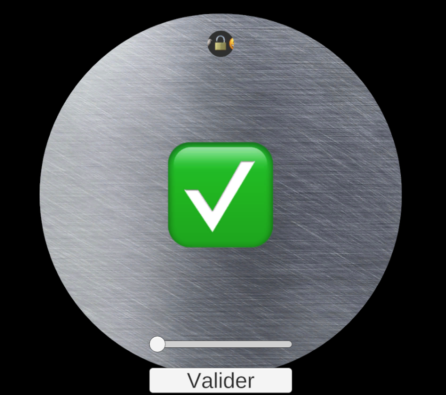
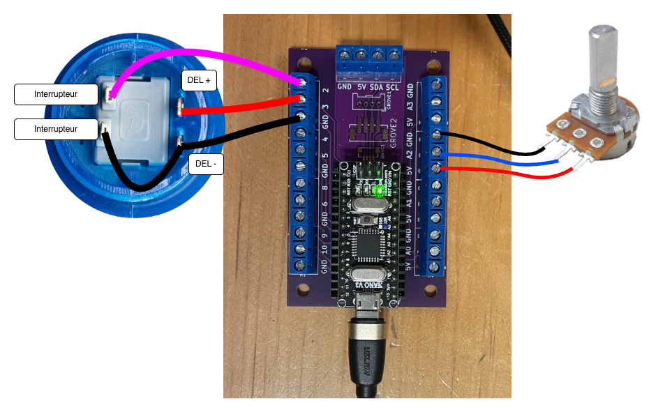
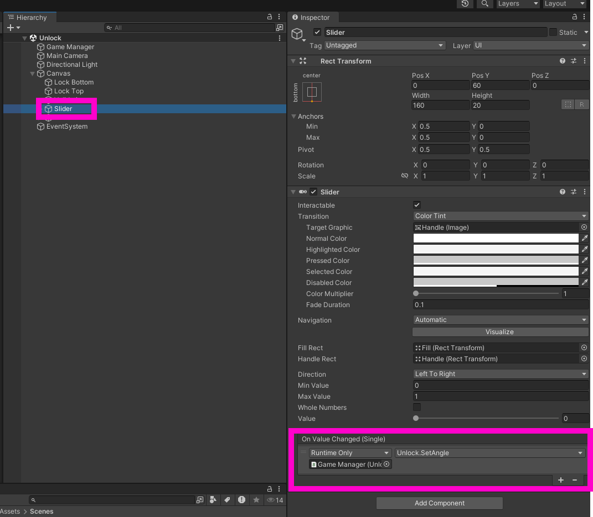
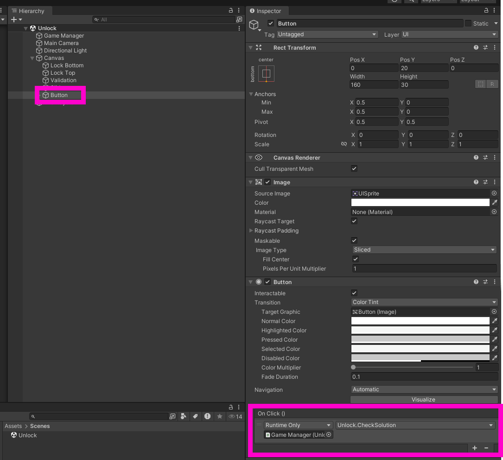

# Tutoriel «Unlock» : OSC bidirectionnel entre Unity, Pd et Arduino Nano avec bouton d’arcade et potentiomètre

Dans ce tutoriel, nous voulons contrôler le jeu [thomasfredericks/unlock_unity)](https://github.com/thomasfredericks/unlock_unity) avec un [potentiomètre](/fabrication/electronique/composants/potentiometre/) pour la rotation de la roulette, et un bouton d’arcade pour valider notre choix.   

Dans le jeu, il faut tourner la roulette pour trouver l’icône du cadenas et appuyer sur le bouton pour valider notre choix.




## Comportement désiré du potentiomètre

- Quand on tourne le potentiomètre :
    - Arduino envoie le message OSC SLIP `/tourner` suivi d’un argument entre `0` et `1023` à Pd.
    - Pd le relaye par UDP à Unity.
    - Unity contrôle la rotation de la roulette.


> [!IMPORTANT]
> Nous traitons le potentiomètre comme un **flux continu**.
> La valeur est lue continuellement et envoyée de façon régulière à Unity.
> Sa valeur se situe dans une plage de valeurs (typiquement entre `0` et `1023` inclusivement).


## Comportement désiré du bouton

- Quand on appuie sur un bouton d’Arcade :
    - Arduino envoie le message OSC SLIP `/valider 1` à Pd.
    - Pd le relaye par UDP à Unity.
    - Unity valide si le cadenas est débarré.


> [!IMPORTANT]
> Nous traitons le bouton comme un **événement discret**.
> Le message n’est envoyé que lors de l’appui ou du relâchement.
> Si le bouton est maintenu, rien de nouveau n’est envoyé.
> Sa valeur est booléenne : `0` ou `1`.

## Comportement désiré de la DEL

- Quand l’utilisateur trouve la solution du jeu, la lumière du bouton s’illumine.

> [!IMPORTANT]
> Nous allons envoyer un message de Unity vers l’Arduino


## Circuit



Brancher un [bouton d’arcade](/fabrication/electronique/composants/bouton/arcade/) au circuit :
*   Un côté de l’interrupteur -> broche 2 de l’Arduino.
*   DEL+ du bouton -> broche 3 de l’Arduino.
*   Les deux autres câbles -> GND de l’Arduino.

Brancher un [potentiomètre](/fabrication/electronique/composants/potentiometre/) au circuit :
*   Broche centrale du potentiomètre -> broche A2 sur l’Arduino.
*   Les deux autres broches -> 5V et GND.


## Code Arduino

- Créer un nouveau Git nommé `unlock_arduino`.
- Le cloner et y démarrer un [nouveau projet PlatformIO](/fabrication/platformio/nouveau/) pour Arduino Nano.
- Ajouter les bibliothèques [Chrono](/fabrication/arduino/chrono/) et [Bounce](/fabrication/arduino/bounce2/) à `platormio.ini`.
- Ajouter la bibliothèque [MicroOsc](/fabrication/arduino/microosc/slip/).

### Initialiser MicroOsc

- Ajouter `#include <MicroOscSlip.h>` dans l’espace global.
- Dans l’espace global, instancier un `MicroOscSlip<128>` nommé `monOsc` et lié à `Serial` : 
```cpp
MicroOscSlip<128> monOsc(&Serial); 
```
- Dans `setup()`, initialiser `Serial` :
```cpp
Serial.begin(115200);
```

### Interrupteur du bouton d’arcade

- Ajouter `#include <Bounce2.h>` dans l’espace global.
- Dans l’espace global, instancier un `Bounce2::Button` nommé `bouton` : 
```cpp
Bounce2::Button bouton;
```
- Dans `setup()`, initialiser le bouton :
```cpp
    bouton.attach(2, INPUT_PULLUP);
    bouton.setPressedState(LOW);
```
- Dans `loop()`, mettre à jour le bouton :
```cpp
    bouton.update();
```
- Dans `loop()`, le moment que le bouton est appuyé, envoyer le message OSC `/valider 1`:
```cpp
    if (bouton.pressed()) { // Bouton vient d’être appuyé
        monOsc.sendInt("/valider", 1);
    }
```

### Potentiomètre

Pour générer un flux continu, nous allons utiliser la bibliothèque [Chrono](/fabrication/arduino/chrono/) pour lire la valeur du potentiomètre à intervalles réguliers.

- Ajouter `#include <Chrono.h>` dans l’espace global.
- Dans l’espace global, instancier un `Chrono` nommé `chronoPot` : 
```cpp
Chrono chronoPot;
```
- Dans `loop()`, envoyer le message OSC `/tourner` suivi de la valeur du potentiomètre à chaque 20 millisecondes :
```cpp
if ( chronoPot.hasPassed(20)) { // SI LE CHRONO DÉPASSE 20 MILLISECONDES
    chronoPot.restart(); // REPARTIR LE CHRONO

    // LE 2 CI_BAS CORRESPOND À LA BROCHE ANALOGIQUE A2
    int valeur = analogRead(2); // LECTURE DE LA TENSION DE LA BROCHE A2 ENTRE 0 ET 1023

    monOsc.sendInt("/tourner", valeur); // ENVOYER LA VALEUR
}
```

### Configuration de la DEL du bouton

- Dans `setup()`, initialiser la DEL du bouton :
```cpp
    pinMode(3,OUTPUT);
```


### Réception de l’OSC

- Dans l’espace global, ajouter une fonction qui sera appelée lorsqu’un message OSC  :
```cpp
// FONCTION APPELÉE LORSQU’UN MESSAGE OSC EST REÇU
void traiterMessageOsc(MicroOscMessage & message) {
    // SI L’ADRESSE DU MESSAGE EST "/lumiere" ET QUE LE MESSAGE CONTIENT UN ARGUMENT ENTIER ("i") :
     if (message.checkOscAddressAndTypeTags("/lumiere", "i")) {  

        int valeur = message.nextAsInt();  // RÉCUPÉRER L’ENTIER ("i")

        digitalWrite(3, valeur); // ASSIGNER LA VALEUR A LA DEL
   } 
```
- Ajouter au début de `loop()`, un appel à la fonction `onOscMessageReceived` qui va déclencher `traiterMessageOsc` si un message est reçu :
```cpp
monOsc.onOscMessageReceived(traiterMessageOsc); // ACQUISITION DES MESSAGES
```


> [!NOTE]
> Téléverser le code sur l’Arduino.
> Cela crée un flux d’environ ~50 messages par seconde (un message par 20 millisecondes) vers Pure Data.

### Pure Data

Télécharger le patcher [relais_osc_slip_udp_bidirectionnel.pd](/logiciels/pd/osc/relais/relais_osc_slip_udp_bidirectionnel.pd), le copier dans le dossier de projet Arduino et configurer [comport](/logiciels/pd/serie/comport).

### Préalables Unity

- Fourcher (*forker*) le dépôt [thomasfredericks/unlock_unity)](https://github.com/thomasfredericks/unlock_unity) .
- Le cloner sur votre ordinateur.
- Il y aura ainsi deux dépôts Git pour ce tutoriel :
    - `unlock_arduino` : qui contient le code Arduino et Pure Data.
    - `unlock_unity` : qui contient le code Unity.
- Essayer de jouer au jeu **avant** de le modifier.
    - Utiliser la glissière pour tourner la roulette.
    - Lorsque l’image du cadenas ouvert est trouvé, appuyer sur le bouton `Valider`.

## Modifications au code Unity

### extOSC

- Suivre les instructions pour l’intégration d’extOSC : [Unity : OSC UDP avec extOSC](/logiciels/unity/osc/extosc/).

> [!NOTE]
> Il faut s’assurer que les # de ports OSC dans Pd et dans Unity se correspondent.
> Il y a des # de ports entrants et sortants !

### Investiguer le code Unity

Il faut identifier le code Unity pour trouver comment le jeu est contrôlé.

Sur le GameObject `Canvas > Slider` on trouve dans la section `On Value Changed` une référence à `Unlock.SetAngle` qui est sur le GameObject `GameManager`.



Sur le GameObject `Canvas > Button` on trouve dans la section `On Click` une référence à `Unlock.CheckSolution` qui est sur le GameObject `Game Manager`.



Si on ouvre le script `Unlock` qui est sur le GmeObject `Game Manager` on trouve les fonctions suivantes dans le code :
```csharp
//...
public void CheckSolution()  {
    //...
}
//...
public void SetAngle(float normalizedValue)  {
    //...
}
//...
```
Aussi dans le script `Unlock`, il y existe cette méthode qui retourne vrai ou faux selon si le joueur a trouvé la solution :
```csharp
//...
public bool isUnlocked() {
    //...
}
//...
```

### Pointer vers le script Unlock du GameObject GameManager

Pointer vers le script `Unlock` du GameObject `Game Manager` :
- Dans `OscProcess`, ajouter une variable de type `Unlock` nommée `unlock` dans la classe.
- De retour dans l’inspecteur de l’éditeur Unity, lier le GameObject `Game Manager` à la propriété `unlock` du script `OscProcess` du GameObject `OSC`.


### Le potentiomètre

La lecture du potentiomètre donne des valeurs entre 0 et 1023. Nous devons ajuster la plage de ces valeurs pour qu’elles correspondent aux coordonnées de position verticale de la palette.

- Nous savons que la méthode pour tourner la roulette est `SetAngle` du script `Unlock`.
- Dans `OscProcess`, effectuer un [Bind int vers argument float d’une méthode](/logiciels/unity/osc/extosc/bind/int_float/) entre le message `/tourner` et la **destination** qui est la méthode `SetAngle` du script `Unlock`. 

### Le bouton

- Nous savons que la méthode pour valider le résultat est `CheckSolution` du script `Unlock`.
- Dans `OscProcess`, effectuer un [Bind int traité dans un if](/logiciels/unity/osc/extosc/bind/int_if/) entre le message `/valider` et la **destination** qui est la méthode `CheckSolution` du script `Unlock`. 

### La DEL

- Dans `OscProcess`, nous allons envoyer à Pd qui va effectuer le relais à l’Arduino, le message `/lumiere` à chaque `Update()`. Ajouter le code suivant à `Update()` :
```csharp
if ( unlock.isUnlocked() ) {
    var oscMessage = new OSCMessage("/lumiere"); 
    oscMessage.AddValue( OSCValue.Int(1) ); // Ajoute l’entier 1
    oscTransmitter.Send( oscMessage ) // Envoyer le message 
} else {
    var oscMessage = new OSCMessage("/lumiere"); 
    oscMessage.AddValue( OSCValue.Int(0) ); // Ajoute l’entier 0
    oscTransmitter.Send( oscMessage ) // Envoyer le message 
}
```

## Tester le tout

> [!WARNING]
> Ne pas oublier de faire les révisions (*commits*) des deux dépôts :
> - `unlock_arduino` : qui contient le code Arduino et Pure Data.
> - `unlock_unity` : qui contient le code Unity.